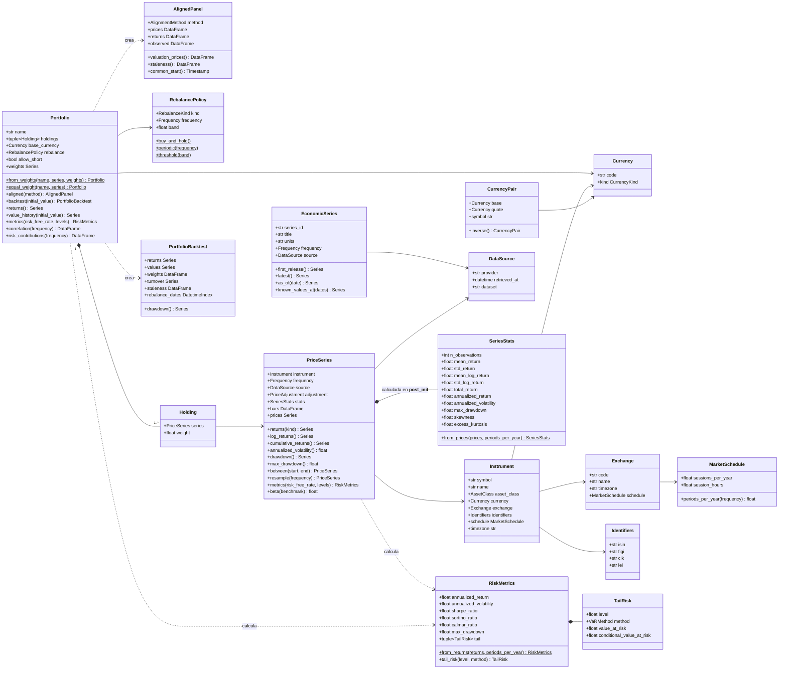

# Modelo de dominio

El dominio (`investinglab.domain`) contiene los objetos con los que trabaja todo el sistema.
Todos son `@dataclass(frozen=True, slots=True)`, se validan al construirse (ver
[ADR-0006](../adr/0006-strict-input-validation.md)) y no hacen I/O. Sus cálculos se delegan en
el núcleo numérico `investinglab.analytics`.

## Diagrama de clases

## Responsabilidades

| Objeto | Responsabilidad |
|--------|-----------------|
| `Currency`, `CurrencyPair`, `QuoteUnit` | Divisas ISO 4217 validadas; `parse_quote_currency` resuelve unidades menores (`GBp` → GBP × 0,01) |
| `Frequency`, `MarketSchedule` | Frecuencias de 1 minuto a 1 año y anualización según el mercado ([ADR-0007](../adr/0007-time-representation.md)) |
| `Exchange`, `Instrument`, `Identifiers` | Metadatos del activo; ISIN y LEI con checksum verificado |
| `PriceSeries` | Serie OHLCV o de cierre ajustado inmutable y validada; estadísticos automáticos al construirse |
| `EconomicSeries` | Serie macro bitemporal *point-in-time* ([ADR-0009](../adr/0009-point-in-time-economic-series.md)) |
| `AlignedPanel` | Alineación multiactivo sin inventar datos ([ADR-0008](../adr/0008-alignment-without-artificial-fill.md)) |
| `Portfolio`, `Holding`, `RebalancePolicy` | Cartera con pesos validados (suma 1, cortos solo explícitos, misma divisa y frecuencia), historia con rebalanceo, métricas, correlaciones y contribución al riesgo ([ADR-0013](../adr/0013-risk-metrics-and-portfolio-engine.md)) |
| `PortfolioBacktest` | Trayectoria histórica: retornos, valor, pesos, rotación y antigüedad de las valoraciones |
| `RiskMetrics`, `TailRisk` | Rentabilidad, volatilidad, Sharpe, Sortino, Calmar, drawdown y VaR/CVaR (histórico, normal y Cornish-Fisher) |

## Inmutabilidad

Las `dataclass` son `frozen`, así que sus atributos no se pueden reasignar. Los datos tabulares
se guardan en un DataFrame privado y cada accesor (`bars`, `prices`, `returns()`…) devuelve un
objeto nuevo. Con pandas 3 (*Copy-on-Write* siempre activo) esos objetos comparten memoria
con la serie, pero cualquier modificación provoca una copia privada. La serie validada no
puede alterarse.
