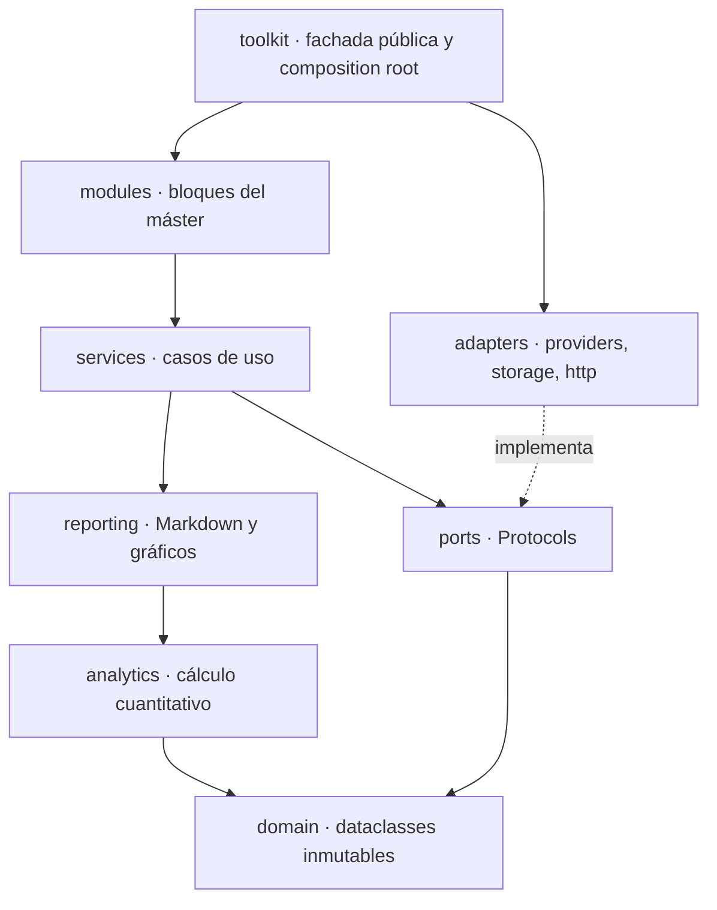

# Arquitectura

InvestingLab sigue una **arquitectura hexagonal** (puertos y adaptadores) dentro de un
monorepo ([ADR-0002](../adr/0002-hexagonal-monorepo-with-independent-core.md)). Las
dependencias apuntan siempre hacia el dominio: el dominio no conoce ni las APIs externas, ni
FastAPI, ni la base de datos.

## Capas del núcleo (`packages/investinglab`)

| Capa | Responsabilidad | Puede importar |
|------|-----------------|----------------|
| `domain` | Value objects y entidades inmutables (`frozen=True`, `slots=True`), validación de invariantes | Solo librería estándar, NumPy, pandas, Pydantic |
| `ports` | Interfaces (`Protocol`) que el núcleo espera del exterior | `domain` |
| `analytics` | Cálculo cuantitativo puro: retornos, riesgo, simulación | `domain` |
| `reporting` | Informes Markdown y gráficos estáticos | `analytics`, `domain` |
| `services` | Casos de uso que orquestan puertos, analytics y reporting | capas internas |
| `adapters` | Implementaciones concretas de los puertos (HTTP, Parquet, DuckDB) | `ports`, `domain`, `config` |
| `modules` | Contenido específico de cada bloque del máster | `services` y capas internas |
| `toolkit` | Fachada pública y composition root para notebooks | todo |

`config` (settings y logging) es transversal y lo usan los adaptadores y las aplicaciones;
el dominio tiene prohibido importarlo.

## Cómo se verifica

Las reglas no dependen de la disciplina: `import-linter` las comprueba en cada commit
(pre-commit) y en CI. Los contratos están en `pyproject.toml`, sección `[tool.importlinter]`:

- capas en el orden de la tabla (una capa externa puede importar una interna, nunca al revés);
- el dominio no importa I/O, frameworks, gráficos ni configuración;
- analytics no hace I/O ni gráficos;
- casos de uso y puertos no importan infraestructura concreta.

Los diagramas de clases y de secuencia se añadirán con las fases F1–F5.
