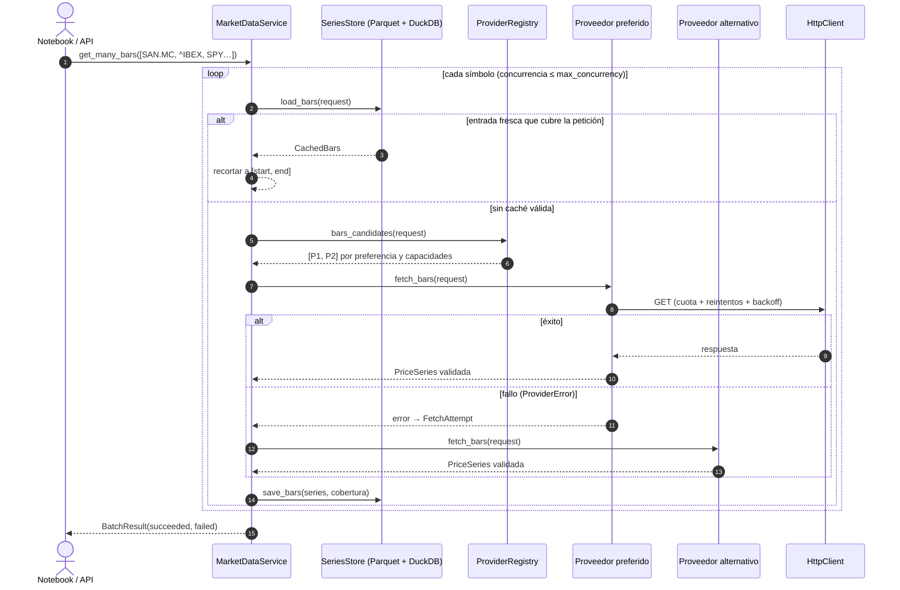

# Ingesta de datos de mercado

Flujo de una petición de precios ([ADR-0010](../adr/0010-multi-provider-ingestion.md),
[ADR-0011](../adr/0011-parquet-duckdb-cache.md), [ADR-0012](../adr/0012-resilient-http-client.md)).

## Diagrama de secuencia

## Componentes

| Componente | Capa | Responsabilidad |
|------------|------|-----------------|
| `BarsRequest`, `EconomicRequest` | `ports` | Qué se pide: símbolo o serie, frecuencia, fechas, modo de *vintage* |
| `ProviderCapabilities`, `RateLimit` | `ports` | Qué puede servir cada proveedor y con qué cuotas |
| `MarketDataProvider`, `EconomicDataProvider` | `ports` | Contrato de los adaptadores: devuelven objetos del dominio |
| `ProviderError` y subclases | `ports` | Errores homogéneos con `retryable` |
| `ProviderRegistry` | `services` | Registro y orden de preferencia |
| `MarketDataService` | `services` | Caché → candidatos → *fallback* → `DataUnavailableError` / `BatchResult` |
| `HttpClient` | `adapters/http` | Reintentos, cuotas, traducción de errores, secretos fuera de los logs |
| `ParquetSeriesStore` | `adapters/storage` | Caché autodescriptiva, escritura atómica, catálogo con DuckDB |

Los adaptadores de cada proveedor (Yahoo, Alpha Vantage, FRED/ALFRED, BCE…) se añaden en la
fase F2b, sin cambiar nada de lo anterior.
