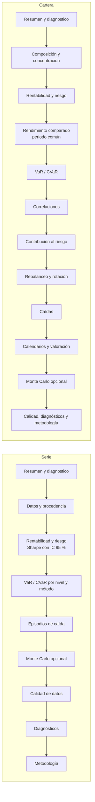

# Informes y gráficos

Cada serie y cada cartera genera su propio informe en Markdown y sus gráficos (requisito 4.5
del taller). Las decisiones de diseño están en
[ADR-0017](../adr/0017-bilingual-reports-and-charts.md).

## Uso

```python
from investinglab.domain import SimulationConfig

report = portfolio.report()  # español por defecto
report_en = portfolio.report(
    language="en",
    risk_free_rate=0.03,  # o la serie point-in-time del tipo libre de riesgo
    simulation=SimulationConfig(n_paths=20_000, horizon=252),
)
report.save("informes/cartera.md")

plots = portfolio.plots_report()  # requiere el extra `plots`
plots["growth"]  # una figura de matplotlib
plots.save("informes/graficos")  # growth.png, drawdown.png, correlation.png...
```

En un notebook, el informe se muestra como Markdown formateado y `plots_report()` muestra
todas las figuras con su pie. Las mismas opciones sirven para los dos métodos y se pueden
pasar por nombre o como `ReportOptions`.

| Opción | Para qué sirve |
|--------|----------------|
| `language` | `es` (por defecto) o `en` |
| `title` | Título propio |
| `risk_free_rate` | Tipo anual en decimal para Sharpe y Sortino: constante o serie *point-in-time* |
| `confidence_levels` | Niveles del VaR y del CVaR (por defecto 95 % y 99 %) |
| `top_drawdowns` | Episodios de caída listados |
| `quality` | Informes de calidad ya calculados, p. ej. con el calendario oficial |
| `simulation` | Añade Monte Carlo: una `SimulationConfig` o un resultado ya calculado |
| `correlation_frequency` | Fuerza la frecuencia de las correlaciones (automática por defecto) |
| `rolling_window` | Ventana de la volatilidad móvil (unos tres meses por defecto) |

## Qué contiene



## Diagnósticos

Un informe no solo da cifras: también dice cuándo no conviene fiarse de ellas. Cada
diagnóstico indica:

* su gravedad (información, advertencia o crítico);
* lo que se ha detectado, con las cifras que lo justifican;
* una recomendación.

Algunos ejemplos:

* El intervalo del Sharpe incluye el cero: la rentabilidad ajustada al riesgo no es
  estadísticamente distinta de cero.
* Los retornos no son normales (Jarque-Bera): el VaR normal infravalora las colas.
* El VaR al 99 % se apoya en muy pocas observaciones.
* Un activo aporta la mayor parte del riesgo con poco peso, o dos activos están tan
  correlacionados que apenas diversifican.
* La simulación usa la media histórica: se indica su error estándar, que con pocos años de
  datos es enorme.

La lista completa y sus umbrales están en ADR-0017.

## Gráficos

| Clave | Serie | Cartera |
|-------|:-----:|:-------:|
| `price` · precio | ✓ | |
| `growth` · evolución en base 100 frente a cada activo | | ✓ |
| `drawdown` · caída desde máximos, con el mínimo etiquetado | ✓ | ✓ |
| `returns` · distribución con la normal ajustada y el VaR histórico | ✓ | |
| `volatility` · volatilidad anualizada móvil | ✓ | |
| `correlation` · mapa de correlaciones con los valores escritos | | ✓ |
| `risk_contribution` · peso frente a contribución al riesgo | | ✓ |
| `weights` · pesos efectivos frente a objetivos | | ✓ |
| `simulation` · abanico y distribución final de Monte Carlo | opcional | opcional |

Criterios de diseño:

* un único eje y;
* un color fijo por activo;
* rampa divergente rojo ↔ azul con punto medio neutro para las correlaciones;
* etiquetas directas solo donde aportan (último valor, mínimo de la caída).

## Idiomas

Todos los textos están en `investinglab/reporting/i18n.py` como pares `(español, inglés)`.
Para añadir un mensaje:

1. Añade la clave con sus dos versiones; un test exige los mismos *placeholders* en ambas.
2. Úsala con `Translator.text(clave, **valores)`.
3. Formatea las cifras con `percent()`, `number()`, `integer()` o `date()`: en español se
   escriben `12,3 %` y `1.234,5`; en inglés, `12.3%` y `1,234.5`.
4. Si el mensaje lleva un recuento, evita la concordancia (`Rachas de precios idénticos: 3`)
   o usa `plural()`.
