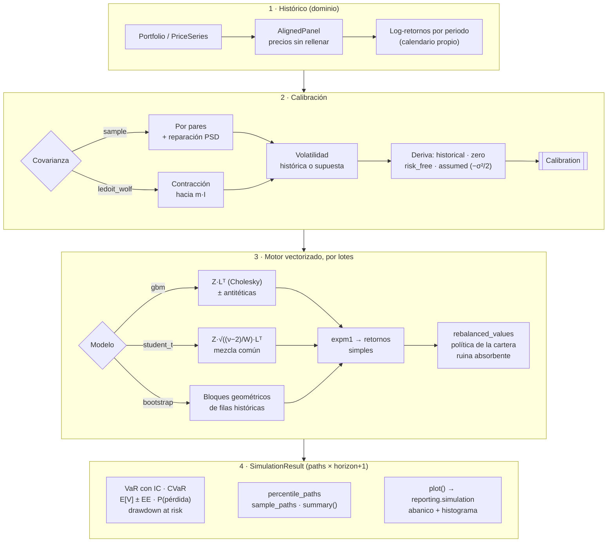

# Simulación de Monte Carlo

La simulación responde a una pregunta: **¿qué puede pasar con esta cartera en el horizonte
elegido, si el futuro se parece al pasado (o a las hipótesis que fijemos)?** Es un método
directo de `Portfolio` y de `PriceSeries`. Las decisiones de diseño están en
[ADR-0016](../adr/0016-monte-carlo-engine.md).

## Flujo



## Uso

```python
from investinglab.domain import (
    DriftAssumption,
    Portfolio,
    SimulationConfig,
    SimulationModel,
)

portfolio = Portfolio.from_weights("Core", [san, itx, sp500_eur], [0.4, 0.3, 0.3])

result = portfolio.monte_carlo(
    SimulationConfig(
        n_paths=20_000,
        horizon=252,  # un año de sesiones
        model=SimulationModel.STUDENT_T,  # colas gruesas
        drift=DriftAssumption.ZERO,  # sin apostar por la media histórica
        seed=7,
    )
)

result.summary()  # tabla con valor esperado, P(pérdida), VaR/CVaR, drawdown
result.value_at_risk(0.99)  # RiskEstimate(value, lower, upper, standard_error)
result.calibration.correlation
figure = result.plot()  # requiere el extra `plots`
```

!!! tip "Elegir la hipótesis de deriva"
    La media histórica de un activo con un 20 % de volatilidad anual tiene, con 5 años de
    datos, un error estándar del ~9 % anual. Simular con `historical` proyecta ese ruido como
    si fuera una certeza. Para medir **riesgo**, `zero` o `risk_free` suelen ser más
    honestos; para planificar, usa `assumed` con expectativas explícitas.

## Cómo leer los resultados

| Medida | Significado |
|--------|-------------|
| `value_at_risk(0.95)` | Pérdida (fracción del valor inicial) que solo se supera en el 5 % de las trayectorias al final del horizonte. Incluye un intervalo de confianza del 95 % que no asume ninguna distribución. |
| `conditional_value_at_risk(0.95)` | Pérdida media en ese 5 % peor (*Expected Shortfall*). Siempre ≥ VaR. |
| `drawdown_at_risk(0.95)` | Caída máxima desde un pico, dentro del horizonte, que solo se supera en el 5 % de las trayectorias. Capta el dolor durante el camino, no solo al final. |
| `probability_of_loss` | Fracción de trayectorias que terminan por debajo del valor inicial. |
| `expected_value_estimate()` | Valor final medio con su error estándar de Monte Carlo. |

Si el intervalo del VaR es demasiado ancho para la decisión que hay que tomar, aumenta
`n_paths`: el ancho se reduce con `1/√n`.

## Visualización

`result.plot()` devuelve una figura de matplotlib con dos paneles:

* **Abanico**:
  * bandas de percentiles 5-95 y 25-75;
  * la mediana;
  * unas pocas trayectorias individuales en gris;
  * el valor inicial como referencia discontinua.
* **Distribución final**: histograma del valor en el horizonte, con la mediana, el VaR y el
  CVaR marcados y etiquetados directamente.

Opciones: `level`, `sample_paths`, `bins` y `title`. Ver
[`simulation_figure`](../reference/reporting.md).
