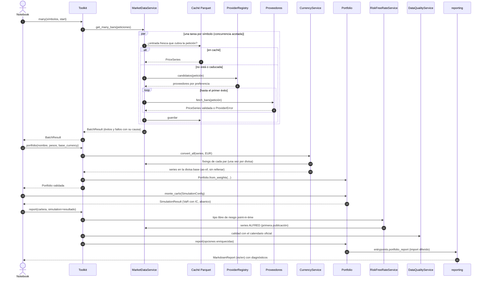

# Flujo completo: ingesta → cartera → simulación → informe

El diagrama sigue el notebook de demostración (`notebooks/b1_toolkit_demo.ipynb`) de principio a
fin. `Toolkit` es la fachada: crea los adaptadores una sola vez (*composition root*) y orquesta
los casos de uso. El dominio no hace I/O; los informes se generan en `reporting`, al que el
dominio llega mediante un import diferido ([ADR-0017](../adr/0017-bilingual-reports-and-charts.md)).

## Qué garantiza cada paso

| Paso | Garantía |
|------|----------|
| 2–11 | Cada símbolo se resuelve por separado: un fallo no aborta el lote y queda registrado con su causa ([ADR-0010](../adr/0010-multi-provider-ingestion.md)). |
| 3–4 | Una entrada de caché solo se usa si cubre las fechas pedidas y no ha caducado. Si caduca, solo se descarga el tramo que falta y se verifica el solape ([ADR-0011](../adr/0011-parquet-duckdb-cache.md), [ADR-0019](../adr/0019-bounded-memory-and-incremental-cache.md)). |
| 7–8 | Los proveedores devuelven objetos del dominio ya validados, nunca *payloads* crudos ([ADR-0006](../adr/0006-strict-input-validation.md)). |
| 13–15 | La conversión usa el último fixing publicado; sin fixing, la observación se descarta ([ADR-0014](../adr/0014-currency-conversion-and-risk-free-rate.md)). |
| 18–19 | La simulación aplica la política de rebalanceo dentro de cada trayectoria ([ADR-0016](../adr/0016-monte-carlo-engine.md)). |
| 21–22 | El tipo libre de riesgo es el conocido en cada fecha (ALFRED, [ADR-0009](../adr/0009-point-in-time-economic-series.md)); si no hay fuente, el informe lo advierte. |
| 23 | La calidad se mide frente al calendario oficial de cada mercado ([ADR-0015](../adr/0015-data-quality-diagnostics.md)). |
