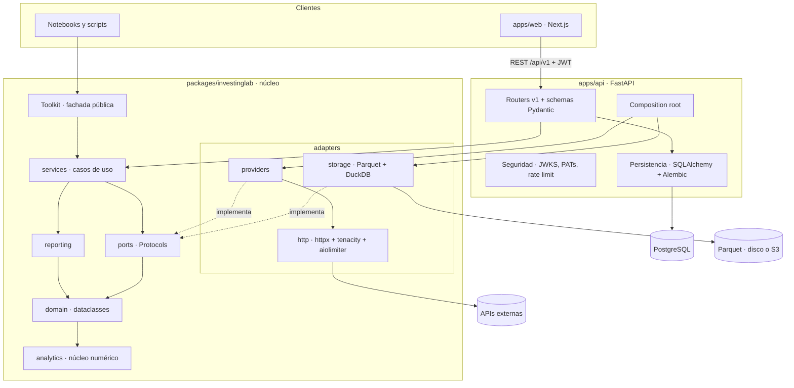
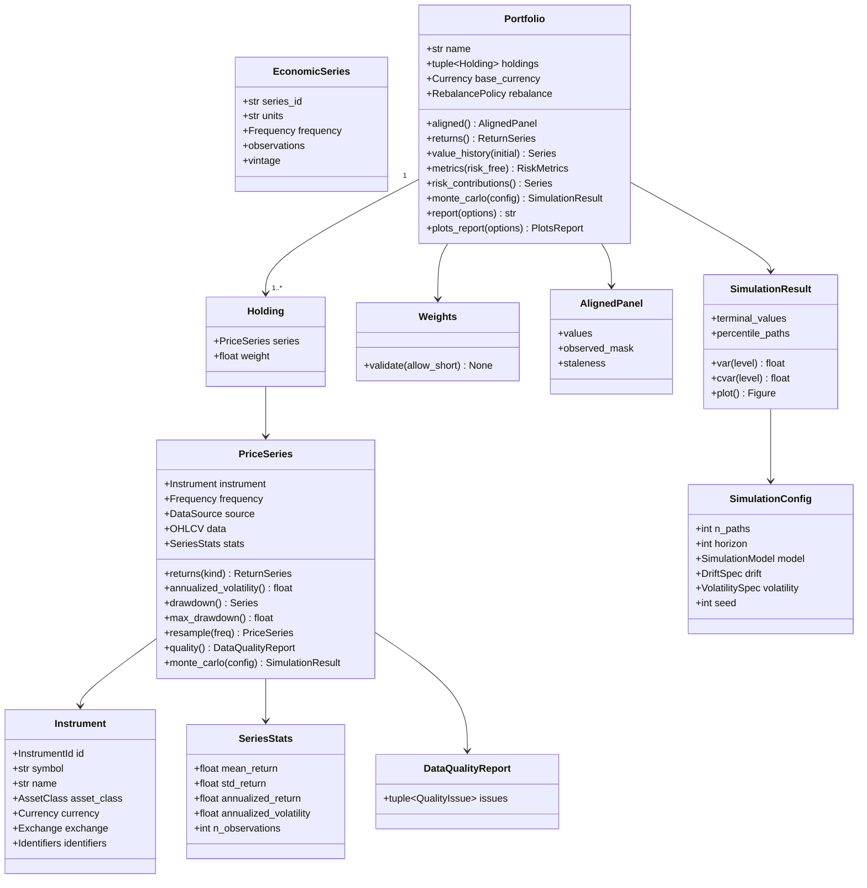

# Plan maestro — InvestingLab

> Estado: **aprobado** (31-10-2026). Producto: **InvestingLab** · paquete núcleo `investinglab`
> · API `investinglab_api` · variables de entorno `INVESTINGLAB_*`.
>
> Este documento es la hoja de ruta viva: se actualiza al cerrar cada fase. Las decisiones
> detalladas se registran como [ADRs](../adr/index.md).

---

## 0. Decisiones tomadas a partir de tus respuestas

| # | Tema | Decisión |
|---|------|----------|
| 1–4 | Contexto | Repo personal, sin plazo. Objetivo: calidad de producto, no de práctica. B1-T1 se cumple al 100 % como primer módulo. |
| 3 | Estructura | Monorepo políglota con workspace `uv` (Python) y app Next.js. El núcleo es un paquete independiente que **no depende** de FastAPI ni de SQLAlchemy (lo garantiza el empaquetado, no solo la disciplina). |
| 5 | Git | Una rama `feat/*` (o `chore/*`) por fase → PR a `development`, que se mergea con la CI en verde. `main` se crea para releases (`v0.1.0` = B1-T1 completo). |
| 6 | Nombre | **InvestingLab** (paquete `investinglab`, libre en PyPI y npm). |
| 7 | Idioma | Código, docstrings, commits y API en inglés. README, docs y ADRs en español. UI y `report()` bilingües (`es` por defecto, `en` disponible). |
| 13 | Frecuencias | Desde 1 minuto hasta mensual (`1m, 5m, 15m, 30m, 1h, 4h, 1d, 1w, 1mo`). Cada proveedor declara qué frecuencias e histórico máximo sirve, y el router elige el que puede atender la petición. |
| 15 | Cripto | Clase de activo de primer nivel. Integración de CryptoWorld en la sección 9. |
| 16 | Rebalanceo | Política explícita: `BuyAndHold`, `Periodic(freq)` o `Threshold(band)`. Por defecto `Periodic(monthly)`, la misma en el histórico y en Monte Carlo. |
| 17 | Alineación | Nunca se inventan datos. Detalle en la sección 6. |
| 18 | Outliers | Se detectan y se reportan; nunca se borran. |
| 20 | Auth | Better Auth (passkeys + TOTP obligatorio) en la web y verificación JWKS en la API. Detalle en la sección 8. |
| 21 | Despliegue | Local con Docker Compose, diseñado *cloud-ready* (12-factor, almacenamiento de objetos para Parquet, secretos por entorno). |
| 22 | Gráficos | La API devuelve **datos tipados**, nunca especificaciones de gráficos. El frontend pinta con ECharts y Lightweight Charts. Matplotlib solo en el núcleo (`plots_report()` y exportación de informes); seaborn se descartó en F5 por no aportar sobre la paleta propia. Plotly queda fuera. |
| 23 | Docs | Zensical + mkdocstrings-python. |
| 26 | Enunciados | No se sube material de clase. `docs/enunciados/` se ignora en git; en el repo solo queda una matriz de trazabilidad con los requisitos redactada por nosotros. |

---

## 1. Árbol de carpetas

```
investinglab/
├── apps/
│   ├── api/                              # FastAPI (miembro del workspace uv) → paquete investinglab_api
│   │   ├── pyproject.toml
│   │   ├── src/investinglab_api/
│   │   │   ├── main.py                   # app factory
│   │   │   ├── bootstrap.py              # composition root: puertos → adaptadores
│   │   │   ├── settings.py               # pydantic-settings (prefijo INVESTINGLAB_API_)
│   │   │   ├── http/                     # errores RFC 9457, middlewares, request-id, CORS, cabeceras de seguridad
│   │   │   ├── security/                 # verificación JWT (JWKS), PATs, scopes, rate limiting
│   │   │   ├── persistence/              # modelos SQLAlchemy 2.0 async, repositorios, unit of work
│   │   │   ├── v1/                       # un router + schemas por feature
│   │   │   │   ├── market/  macro/  fx/  instruments/  fundamentals/
│   │   │   │   ├── portfolios/  analytics/  simulations/  reports/
│   │   │   │   └── providers/  modules/  me/  tokens/
│   │   │   └── modules/                  # routers aportados por cada bloque del máster
│   │   ├── migrations/                   # Alembic
│   │   └── tests/                        # unit/, integration/ (Postgres real en CI)
│   └── web/                              # Next.js (App Router) + TypeScript estricto
│       ├── src/app/
│       │   ├── (auth)/                   # login, 2FA, passkeys
│       │   └── (platform)/               # dashboard, markets, portfolios, simulations, modules/[slug], settings
│       ├── src/features/                 # lógica de UI por feature (market, portfolio, analysis, simulation…)
│       ├── src/components/ui/            # shadcn/ui
│       ├── src/components/charts/        # wrappers de Lightweight Charts y ECharts
│       ├── src/lib/api/                  # cliente GENERADO con orval (no se edita a mano)
│       ├── src/lib/auth/                 # Better Auth (servidor + cliente)
│       ├── src/modules/                  # una sección por bloque del máster + registry.ts
│       ├── messages/{es,en}.json         # i18n (next-intl)
│       └── e2e/                          # Playwright
├── packages/
│   └── investinglab/                     # NÚCLEO: librería pura, usable desde un notebook
│       ├── pyproject.toml                # extras: [yahoo] [crypto] [plots] [all]
│       ├── src/investinglab/
│       │   ├── domain/                   # dataclasses frozen + slots, sin I/O
│       │   │   ├── instruments.py        # Instrument, InstrumentId, Identifiers, AssetClass, Exchange
│       │   │   ├── money.py              # Currency (ISO 4217, unidades menores GBp→GBP), CurrencyPair
│       │   │   ├── time.py               # Frequency, TradingCalendar, AnnualizationBasis
│       │   │   ├── series.py             # PriceSeries, ReturnSeries, EconomicSeries, SeriesStats
│       │   │   ├── panel.py              # AlignedPanel (valores + máscara de observado + antigüedad)
│       │   │   ├── portfolio.py          # Portfolio, Holding, Weights, RebalancePolicy
│       │   │   ├── quality.py            # DataQualityReport, QualityIssue
│       │   │   ├── simulation.py         # SimulationConfig, SimulationResult
│       │   │   └── errors.py             # jerarquía de errores de dominio
│       │   ├── ports/                    # Protocols: proveedores, almacenamiento, reloj
│       │   ├── services/                 # casos de uso: ingesta, routing, alineación, FX, carteras, calidad
│       │   ├── analytics/                # returns, performance, risk, correlation, attribution, montecarlo/
│       │   ├── reporting/                # Markdown tipado, gráficos (matplotlib), i18n es/en (ADR-0017)
│       │   ├── adapters/
│       │   │   ├── http/                 # cliente httpx común: reintentos, rate limit, logging, User-Agent
│       │   │   ├── providers/            # yahoo/, alphavantage/, fred/, ecb/, … (uno por carpeta)
│       │   │   └── storage/              # Parquet + DuckDB sobre fsspec (disco local o S3/R2)
│       │   ├── modules/                  # registry.py + b1_toolkit/
│       │   ├── config/                   # Settings, logging (structlog)
│       │   └── toolkit.py                # fachada pública async + sync para notebooks
│       └── tests/
│           ├── unit/  property/  contract/  integration/
│           └── fixtures/                 # respuestas reales grabadas + datos sintéticos etiquetados
├── notebooks/                            # demos reproducibles (modo offline con fixtures)
├── docs/                                 # Zensical
│   ├── adr/                              # MADR: 0001-record-architecture-decisions.md, …
│   ├── architecture/                     # Mermaid: capas, clases, secuencias, C4
│   ├── data-sources/                     # ficha por proveedor: límites, licencia, sesgos
│   ├── modules/b1-t1/                    # trazabilidad requisito → código → test
│   └── reference/                        # API reference generada con mkdocstrings
├── infra/
│   ├── docker/                           # Dockerfiles multi-stage (api, web), usuario no-root
│   └── compose/                          # overrides (dev, observabilidad)
├── docker-compose.yml                    # api, web, postgres
├── justfile                              # setup, dev, test, lint, typecheck, gen-client, migrate, record-fixtures, docs
├── pyproject.toml                        # raíz del workspace uv + ruff, mypy, pytest, import-linter
├── uv.lock
├── zensical.toml
├── CLAUDE.md · README.md · .env.example · .pre-commit-config.yaml · .editorconfig
└── .github/
    ├── workflows/                        # python.yml, web.yml, contract.yml (OpenAPI ↔ cliente), docker.yml
    └── dependabot.yml
```

**Por qué esta estructura y no `backend/` + `frontend/`:**

- `packages/investinglab` es la librería del enunciado: se importa en un notebook sin API ni base de datos.
- Como no declara FastAPI ni SQLAlchemy como dependencias, es imposible que el dominio las importe.
- Dentro del núcleo, `import-linter` verifica en CI las reglas de capas:
  - `analytics` es un núcleo numérico puro por debajo del dominio (ver ADR-0002);
  - `domain` solo importa `analytics`;
  - `services` solo depende de `ports`;
  - nadie salvo la fachada y el composition root importa `adapters`.
- `apps/` contiene los entregables desplegables. Mañana puede añadirse `apps/worker` o `apps/cli` sin tocar el núcleo.

---

## 2. Diagrama de capas



Las dependencias siempre apuntan hacia el centro (`domain` y su núcleo numérico `analytics`). Los adaptadores implementan los puertos y solo se instancian en dos composition roots: `Toolkit.from_settings()` para los notebooks y `bootstrap.py` para la API.

---

## 3. Modelo de dominio y puertos

### 3.1 Diagrama de clases (dominio)



**Detalles de diseño relevantes:**

- **`PriceSeries`** es `@dataclass(frozen=True, slots=True)`.
  - En `__post_init__` valida los datos y calcula `SeriesStats` (media y desviación típica de los retornos, como exige el enunciado) a través de un campo `init=False`.
  - Los arrays se copian y se marcan como solo lectura (`writeable=False`) para que la inmutabilidad sea real y no solo superficial.
- **Anualización.** Depende del calendario del activo y de la frecuencia:
  - 252 sesiones al año en equities, 365 días en cripto;
  - en intradía, número de barras por sesión × sesiones al año.

  No hay un 252 cableado en el código.
- **Representación temporal.** Las barras intradía usan timestamps UTC tz-aware. Las diarias o superiores usan etiquetas de sesión con la zona horaria del mercado como metadato. Irá en un ADR propio.
- **`EconomicSeries` es bitemporal.** Distingue fecha de observación, fecha de publicación y vintage (ALFRED). Es un tipo distinto de `PriceSeries`: un tipo de interés no tiene "retornos".
- **FX y futuros** son `PriceSeries` con `AssetClass.FX` o `AssetClass.FUTURE`. Una `CurrencyPair` es un instrumento más.

### 3.2 Puertos (`ports/`)

| Puerto | Responsabilidad |
|--------|-----------------|
| `MarketDataProvider` | `fetch_bars(BarsRequest) -> PriceSeries`, `search(query) -> list[Instrument]`. Declara `ProviderCapabilities`: clases de activo, frecuencias, histórico máximo por frecuencia, autenticación, rate limit y licencia. |
| `MacroDataProvider` | `fetch_series(id, vintage=None) -> EconomicSeries` |
| `FundamentalsProvider` | snapshot, estados financieros point-in-time, acciones corporativas |
| `FxRateProvider` | tipos de cambio oficiales (`CurrencyPair`, intervalo) |
| `InstrumentResolver` | ticker ↔ FIGI / ISIN / CIK y símbolo propio de cada proveedor |
| `SeriesStore` | caché de series: lectura y escritura con metadatos de cobertura, TTL y `retrieved_at` |
| `PortfolioRepository` | persistencia de carteras guardadas (implementado en `apps/api`) |
| `Clock` | tiempo inyectable para tests de TTL y reproducibilidad |

### 3.3 Servicios (casos de uso)

| Servicio | Responsabilidad |
|----------|-----------------|
| `MarketDataService` | Cache-aside, routing por capacidades con fallback ordenado por política, y descarga concurrente de N series. Devuelve `BatchResult` (éxitos y fallos con su causa) sin abortar el lote. Si el proveedor revisa el histórico (por ejemplo, un nuevo ajuste por dividendos), lo detecta y reingesta la serie. |
| `AlignmentService` | Une calendarios distintos sin inventar datos (sección 6). |
| `CurrencyService` | Conversión as-of a la divisa base y descomposición del retorno en activo + divisa (sección 7). |
| `RiskFreeRateService` | Tipo libre de riesgo según la divisa base. |
| `PortfolioService` | Construye la cartera: valida pesos, descarga, alinea y convierte. |
| `DataQualityService` | Huecos frente al calendario oficial, outliers (z-score robusto con MAD), precios congelados, splits sospechosos, volumen cero. |
| `SimulationService` y `ReportService` | Orquestan analytics y reporting. |

### 3.4 Política de validación estricta (requisito 4.5, irá en un ADR)

**No se acepta cualquier cosa que "parezca" una serie de precios.** Un `PriceSeries` exige:

- índice temporal tipado, monótono y sin duplicados;
- precios finitos y estrictamente positivos;
- divisa ISO conocida;
- frecuencia declarada y coherente con el índice;
- procedencia (`DataSource`);
- longitud mínima para sus estadísticos.

Las entradas externas (CSV, DataFrames de usuario) pasan antes por un `SeriesImporter` con Pydantic. Si algo falla, el error es tipado y explica qué falló y dónde.

**Por qué:** un error silencioso en la entrada (precio en peniques frente a libras, split sin ajustar, zona horaria mal puesta, frecuencia mezclada) contamina todas las métricas aguas abajo sin que nadie lo note. Fallar pronto y con claridad es más barato que depurar un Sharpe falso.

---

## 4. Fuentes de datos

Investigué el estado actual de cada proveedor. Los límites de los planes gratuitos cambian a menudo, así que cada adaptador declara sus límites como configuración y `docs/data-sources/` tendrá una ficha por fuente.

| Fuente | Qué aporta | Frecuencias | Acceso | Notas | Fase |
|--------|-----------|-------------|--------|-------|------|
| **Yahoo Finance** (endpoint `chart`, [ADR-0025](../adr/0025-yahoo-chart-adapter-and-cassettes.md)) | Acciones, índices, ETFs, FX, futuros y cripto; fundamentales, dividendos/splits, opciones | 1m…1mo (1m ≈ 30 días; ≤30m ≈ 60 días; 1h ≈ 2 años) | Sin clave | Sin SLA y con throttling (429) frecuente → caché, rate limit y fallback | F2 |
| **Alpha Vantage** | Acciones/ETF, FX, cripto, intradía, fundamentales, noticias con sentimiento | 1m…1mo | Clave gratuita | 25 peticiones/día; el ajustado es premium; sin índices. Fallback de equities y validación cruzada | F2 |
| **FRED + ALFRED** | Macro, tipos, FX (`DEX*`), vintages point-in-time | D…A | Clave gratuita (la misma para ambos) | **Modo ALFRED por defecto**: cada dato con su fecha de publicación (primera publicación, `output_type=4`); el modo "último valor revisado" es opcional. Sin clave, *fallback* al CSV público `fredgraph.csv`, que solo da el último valor y queda marcado como no point-in-time | F2 |
| **BCE Data Portal** (SDMX) | €STR, tipos de cambio de referencia, curvas cupón cero, HICP | D, M | Sin clave | Fuente oficial para EUR | F2 |
| **Tiingo** | EOD EE. UU. ajustado (30+ años), intradía IEX, cripto | 1m…1d | Clave gratuita | Licencia de uso personal | F11 |
| **Alpaca Market Data** | Barras de EE. UU. por minuto desde 2016; cripto | 1m…1d | Cuenta gratuita | En el plan free se bloquean los últimos 15 minutos; la mejor fuente gratuita de intradía de EE. UU. | F11 |
| **SEC EDGAR** | Fundamentales XBRL con fecha de presentación (point-in-time), 10-K/10-Q/8-K para NLP | Q, A, eventos | User-Agent con email | 10 peticiones/s | F11 |
| **OpenFIGI + SEC tickers + GLEIF** | Maestro de instrumentos (FIGI, CIK, LEI) | — | Clave opcional | El ticker deja de ser la clave primaria | F11 |
| **DBnomics** | Agregador: FMI, OCDE, BIS, Banco Mundial, Eurostat… | Varias | Sin clave | Un adaptador da acceso a más de 90 organismos | F11 |
| **Eurostat, Banco de España, INE** | Macro europea y española | M, Q, A | Sin clave | APIs oficiales | F11 |
| **US Treasury** (FiscalData, par yield curve) | Curva oficial de EE. UU. | D | Sin clave | | F11 |
| **Kenneth French Data Library** | Factores Fama-French, momentum, carteras | D, W, M | Sin clave | Base de los modelos factoriales de bloques futuros | F11 |
| **Global-q (Hou-Xue-Zhang)** y **Goyal-Welch** | Factores q5; predictores macro clásicos (dp, ep, tms, dfy, infl…) | M, A | Sin clave | Vistos en los notebooks del máster (con `tidyfinance` como referencia) | F11 |
| **SIX Market Signal** (SIX 1BBO) | Cotizaciones (bid/ask) y operaciones de más de 4.000 acciones europeas, BME incluida, por ISIN | Tiempo real (solo el día en curso) | Token (`pk_…`) | Prueba de 1 mes con 1 petición/s y sin redistribución. Base de analítica de liquidez (spread en pb) | F11 |
| **Cboe** | Histórico del VIX y otros índices de volatilidad | D | Sin clave | | F11 |
| ***Venues* cripto** (Binance ✅, OKX ✅, Bybit, Kraken, Coinbase) | Velas cripto con histórico completo y flujo por vela; funding, interés abierto, foto del libro y ratio de largos y cortos donde hay perpetuos | 1m…1mo | Endpoints públicos | Un adaptador por *venue* sobre `HttpClient`, con casetes ([ADR-0032](../adr/0032-crypto-venues-on-the-shared-http-client.md)); sustituye a los clientes propios de CryptoWorld | G1 |
| **data.binance.vision** | Volcados históricos de velas y de operaciones agregadas | 1m… | Sin clave | Histórico largo sin gastar cuota de la API | G1, G11 |
| **CoinGecko** | Capitalización, dominancia, metadatos | D | Clave demo gratuita | La clave demo no es de uso comercial | G1 |
| **alternative.me** | Fear & Greed cripto | D | Sin clave | Portada de CryptoWorld | G1 |
| **Deribit** | Superficie de opciones de BTC y ETH (volatilidad implícita, *skew*) | Fotos | Endpoints públicos | Solo cripto; detrás del puerto `OptionsDataProvider` | G5 |
| **Blockscout, Blockchain.com, Blockchair, DefiLlama** | Métricas on-chain, transferencias y direcciones en varias cadenas, TVL | D, eventos | Sin clave | Portadas de CryptoWorld, más DefiLlama | G9 |
| **CryptoCompare** | Noticias cripto | Eventos | Clave | Portada de CryptoWorld | G10 |
| **Massive** (antes Polygon) | Agregados de EE. UU. | 1m…1d | Clave gratuita | 5 peticiones/min, 2 años de histórico | Backlog |
| **CFTC COT** | Posicionamiento en futuros | W | Sin clave | | Backlog |
| **GDELT, Finnhub (noticias)** | Noticias y tono | Eventos | Varía | Futuro módulo de sentimiento | Backlog |
| **CNMV** | Posiciones cortas y hechos relevantes (España) | Eventos | Scraping ético | Frágil: sin API | Backlog |

**Descartadas, por ahora:**

| Fuente | Motivo |
|--------|--------|
| Stooq | Desde marzo de 2026 exige una clave obtenida resolviendo un captcha: no es automatizable. |
| Velas de Finnhub | Pasaron a planes de pago hacia 2025. |
| Nasdaq Data Link | Casi todo es premium; lo útil gratuito ya está en FRED o DBnomics. |
| IEX Cloud | Cerró en 2024. |
| Twelve Data | Redundante; su licencia gratuita es solo para uso personal. |

**Política de routing por defecto** (configurable en `settings`):

| Dato | Orden de proveedores |
|------|----------------------|
| Equities e índices, diario | Yahoo → Tiingo → Alpha Vantage |
| Equities EE. UU., intradía | Alpaca → Yahoo → Alpha Vantage |
| FX | BCE → FRED → Yahoo |
| Cripto | ccxt (Binance) → ccxt (Kraken) → Yahoo (`BTC-USD`) como último recurso |
| Macro | FRED/ALFRED → BCE → DBnomics |

**Almacenamiento:**

- Parquet particionado por `dataset/provider/frequency/symbol/year`, consultado con DuckDB.
- TTL por tipo de dato y descarga incremental (solo el tramo que falta).
- `retrieved_at` en cada escritura, como base de la quality gate que detecta revisiones del histórico.

---

## 5. Monte Carlo (requisito 4.4, con mejoras propuestas)

**Modelos:**
- `GBM` multivariante con Cholesky (por defecto). Si la matriz no es definida positiva, se repara a la matriz PSD más cercana.
- `StudentT` multivariante para colas gruesas.
- `StationaryBootstrap` (Politis-Romano), que conserva la autocorrelación y las correlaciones cruzadas.
- Después: *Filtered Historical Simulation* con GARCH.

**Estimación de parámetros:**
- Covarianza con shrinkage Ledoit-Wolf, más estable que la muestral.
- Drift: `Historical`, `Assumed(μ)`, `Zero` o `RiskFreePlusPremium`. La media histórica es muy ruidosa, y el informe lo advertirá.

**Rendimiento:**
- Totalmente vectorizado con NumPy (sin bucles por simulación).
- Se procesa por lotes con memoria acotada: 10 000 trayectorias × 252 pasos × 20 activos en float64 ocuparían unos 400 MB de una vez.
- Variables antitéticas para reducir varianza.

**Salida:**
- Percentiles de trayectorias (abanico) y distribución del valor final.
- VaR y CVaR al 95 % y al 99 %, con **error estándar Monte Carlo e intervalo de confianza**.

**Consistencia y reproducibilidad:**
- El rebalanceo de la cartera se aplica igual dentro de la simulación que en el histórico.
- Semilla con `numpy.random.Generator(PCG64)`. El resultado guarda la configuración completa para reproducirlo.

---

## 6. Alineación de calendarios sin inventar datos (respuesta a tu punto 17)

Separo tres usos distintos, porque cada uno necesita un tratamiento diferente:

1. **Estadísticos por activo.** Cada serie se analiza sobre su propio calendario, sin relleno. Los huecos se contrastan con el calendario oficial del mercado (`exchange_calendars`) para distinguir un festivo de un dato que falta.

2. **Estadísticos entre activos** (covarianza, correlación, Monte Carlo):
   - Los retornos se calculan en el calendario de cada activo y luego se unen por fecha (*outer join*).
   - Un día de festivo en Madrid queda como **NaN**, no como 0 %. El retorno acumulado del puente se asigna a la siguiente sesión real, así que no aparecen ceros ficticios que bajen la volatilidad y la correlación.
   - La covarianza usa observaciones *pairwise-complete* con reparación PSD.
   - Para carteras que mezclan Europa y EE. UU., el informe avisa del sesgo por **trading no sincrónico** (cierres con 6 horas de diferencia) y ofrece la correlación semanal como alternativa robusta.

3. **Valoración de la cartera** (evolución del valor):
   - Se usa el último precio de cierre **observado**, que es el mark-to-market correcto: es el criterio con el que se calcula el NAV de un fondo.
   - Cada punto lleva su **antigüedad** (sesiones desde la última observación real) y el informe la muestra.
   - Nunca se presenta como una observación nueva.

**Reglas fijas:**
- Prohibidos el `bfill` y la interpolación.
- La macro mensual o trimestral se une *as-of* por fecha de publicación (vía ALFRED), nunca por fecha de observación.

---

## 7. Divisas y tipo libre de riesgo (respuesta a tu punto 11)

**Divisas:**
- Cada serie conserva su divisa nativa.
- Las unidades menores se normalizan: Yahoo da las acciones de Londres en peniques (GBp → GBP / 100), un error clásico.
- La cartera tiene una **divisa base configurable** (EUR por defecto).
- La conversión es *as-of*: el precio en *t* usa el último fixing conocido en *t*. El fixing del BCE (~16:00 CET) es anterior a los cierres de Madrid y de Nueva York, así que no hay *look-ahead*.

**Tipos de cambio:**
- Orden de fuentes: BCE (oficial) → FRED `DEX*` → Yahoo (intradía y pares exóticos).
- Los cruces que falten se triangulan vía EUR o USD.

**Atribución del retorno:**
- El informe separa **retorno del activo en moneda local** y **contribución de la divisa**. Para un inversor en euros, el riesgo divisa es riesgo real.
- La cobertura de divisa queda para más adelante.

**Tipo libre de riesgo según la divisa base:**

| Divisa | Fuente |
|--------|--------|
| EUR | €STR del BCE; antes de octubre de 2019, tipo de depósito del BCE |
| USD | SOFR o T-Bill a 3 meses (FRED) |
| GBP | SONIA (más adelante) |

La conversión a tipo por periodo usa la convención del mercado monetario (ACT/360). El Sharpe y el Sortino usan siempre el tipo de la divisa base.

---

## 8. Autenticación (respuesta a tu punto 20)

**Recomendación: Better Auth en Next.js con patrón BFF, y la API como *resource server* OIDC estándar.**

**En la web, con Better Auth:**
- Contraseña con hash fuerte.
- **Passkeys (WebAuthn)**.
- **2FA TOTP obligatorio** con códigos de recuperación.
- Sesiones en Postgres (esquema `auth` separado), en cookies `HttpOnly`, `Secure` y `SameSite=Lax`, con protección CSRF.
- Rate limiting en login.
- **Registro público deshabilitado**: el primer usuario se crea por CLI. La app es personal, pero ya queda preparada para multiusuario.

**En la API:**
- Recibe JWT de corta duración, firmados con EdDSA.
- Los verifica contra el **JWKS** publicado por la web con PyJWT. No contiene lógica de login.
- Si mañana se migra a Keycloak, Zitadel o Auth0, solo cambian el *issuer* y la URL del JWKS: la verificación está detrás del puerto `TokenVerifier`.

**Para notebooks y scripts:**
- **Personal Access Tokens** emitidos por la API: con scopes y caducidad, revocables, almacenados como hash y mostrados una sola vez.

**Seguridad transversal:**
- Rate limiting por usuario y por IP.
- CORS estricto.
- Cabeceras de seguridad (CSP, HSTS).
- Auditoría de eventos de seguridad.
- `gitleaks` en pre-commit.

**Alternativas descartadas:**

| Alternativa | Motivo |
|-------------|--------|
| Auth propia en FastAPI | Más código crítico que mantener y auditar. |
| Keycloak autoalojado | Excesivo para un único desarrollador. |
| Clerk / Auth0 | Dependencia de un proveedor y datos de usuario fuera de casa. |

---

## 9. Integración con CryptoWorld (respuesta a tu punto 15)

**Qué hay en CryptoWorld.** La primera versión de esta sección describía una versión muy anterior. La rama `develop` (1.346.1, octubre de 2026) es bastante más:

| Esta sección decía | `develop` 1.346.1 tiene |
|---|---|
| «Unas 25k líneas» | Unas 77k de backend (49k de código y 28k de tests) y 36k de frontend |
| «Clientes para Binance, KuCoin y CoinGecko con cadena de *fallback*» | 9 clientes, entre ellos ccxt para órdenes reales, Deribit para opciones y Blockscout para cuatro cadenas |
| «Motor de análisis técnico de unas 900 líneas» | Indicadores, panel de señales, acción del precio (FVG, *order blocks*, barridas de liquidez, CRT, AMD, ORB), estructura de precio y ficha de confluencia |
| «Predicción con Random Forest y *backtesting*» | Conjunto de modelos con validación cruzada purgada, calibración y predicción conformal; backtest con costes, deslizamiento, funding, cortos y relleno a la apertura siguiente, y una suite de robustez completa |
| (no aparecía) | Generador genético y NSGA-II sobre una gramática de estrategias, registro de pruebas, deflación por el número real de pruebas, CPCV, meta-modelo, incubación |
| (no aparecía) | *Paper trading*, gestión de órdenes con límites y *kill-switch*, ejecución real, análisis de costes de ejecución |
| (no aparecía) | HAR, carry, factores cripto, opciones, rupturas estructurales, calendario económico con estudio de eventos, estacionalidad |

**El detalle está en [Integración de CryptoWorld](integracion-cryptoworld.md)**: inventario de los 19 módulos, mapa de correspondencia pieza a pieza, arquitectura destino, fases G0-G13 y matriz de paridad.

**Propuesta: migración progresiva (*strangler*) hacia esta plataforma**, sin integrarse por HTTP con CryptoWorld ni crear una librería compartida. Los dos proyectos son complementarios: CryptoWorld aporta amplitud funcional y rigor estadístico; esta plataforma, el modelo de datos multiactivo y la calidad de ingeniería. Donde se solapan (HRP, VaR/CVaR, contribución al riesgo, correlaciones, calidad de datos, divisas, Monte Carlo) se queda la versión de aquí.

| Pieza de CryptoWorld | Destino en la nueva plataforma |
|----------------------|--------------------------------|
| Clientes de exchange | Un adaptador por *venue* sobre `HttpClient`, con la notación unificada de símbolos (`BTC/USDT`, `BTC/USDT:USDT`) y casetes ([ADR-0032](../adr/0032-crypto-venues-on-the-shared-http-client.md)); ccxt queda para la ejecución (G7). |
| CoinGecko, on-chain, noticias, Fear & Greed | Adaptadores que implementan puertos del núcleo y devuelven objetos de dominio (G1, G9, G10). |
| Análisis técnico, patrones y estructura | `investinglab.analytics.technical` y `analytics.patterns`, **generalizados a cualquier `PriceSeries`**, en NumPy y con tests de paridad y de propiedades (G2). |
| Backtest y validación | `analytics.backtest` y `analytics.validation`, con costes por mercado, calendario y mundos nulos como puerta (G3). |
| Generador de estrategias y ML | Laboratorio de investigación, con el número de pruebas tomado del registro de experimentos (G4). |
| Volatilidad, carry y relaciones entre activos | `analytics`, con endpoint y pantalla (G5). |
| Cartera del usuario | Libro de operaciones con lotes y divisas; el riesgo, con el motor de aquí (G6). |
| *Paper trading* y ejecución | Dominio de órdenes rediseñado y proceso `apps/trader` aparte, apagado por defecto (G7). |
| Alertas, notificaciones y Celery | Reglas de alerta, canales tras un puerto y el *worker* de la plataforma (G0b, G8). |
| Autenticación | No se porta: se usa la de la sección 8. |

CryptoWorld sigue funcionando tal cual mientras dura la migración. Cuando la nueva plataforma cubra sus funcionalidades, podrás archivarlo o mantenerlo como proyecto académico del TFG.

### ¿Uno o dos repositorios? (31-10-2026)

**Decisión: un único repositorio y una única plataforma (InvestingLab).** CryptoWorld se congela como registro del TFG y su código útil se porta aquí. No se fusionan los historiales de git.

Motivos:

- **Mismo núcleo.** `PriceSeries`, `Portfolio`, riesgo, Monte Carlo e informes sirven igual para BTC que para SAN.MC. Las carteras mixtas (acciones, bonos y cripto) solo son posibles con un modelo común.
- **Una sola autenticación, un solo despliegue, una sola CI y un solo sistema de diseño.** Mantener dos backends (Django y FastAPI) y dos frontends (Vite y Next.js) siendo una sola persona duplica el trabajo y los fallos de seguridad.
- **El cripto encaja como clase de activo y como módulo.** Tiene sus proveedores (ccxt, CoinGecko, on-chain), la sección Cripto en la web y la analítica técnica generalizada.

Tener dos repositorios solo compensaría si cripto fuese un producto separado, con otro equipo o con otros usuarios.

---

## 10. API REST (`/api/v1`)

Los errores siguen **RFC 9457** (`application/problem+json`). La paginación es por cursor y las fechas van en ISO 8601. El OpenAPI se documenta con ejemplos.

| Método | Ruta | Descripción |
|--------|------|-------------|
| GET | `/health/live`, `/health/ready` | Liveness y readiness (BD, almacenamiento) |
| GET | `/api/v1/providers` | Proveedores: capacidades, estado, cuota consumida, último error |
| GET | `/api/v1/modules` | Módulos del máster registrados (alimenta la navegación) |
| GET | `/api/v1/instruments/search?q=` | Búsqueda de instrumentos multi-proveedor |
| GET | `/api/v1/instruments/{id}` | Detalle e identificadores (ISIN, FIGI, CIK) |
| GET | `/api/v1/market/bars` | Barras de un símbolo (`interval`, `start`, `end`, `adjusted`, `provider?`) |
| POST | `/api/v1/market/bars/batch` | N símbolos concurrentes → `{succeeded, failed}` |
| GET | `/api/v1/market/stats` | Estadísticos de una o varias series |
| POST | `/api/v1/market/compare` | Rendimiento normalizado, correlación y drawdown de varios activos |
| GET | `/api/v1/market/quality` | Informe de calidad (huecos, outliers, precios congelados) |
| GET | `/api/v1/fundamentals/{symbol}` | Snapshot y estados financieros (`period=annual\|quarterly`) |
| GET | `/api/v1/macro/series/{source}/{id}` | Serie macro (`vintage?` para point-in-time) |
| GET | `/api/v1/rates/risk-free?currency=` | Tipo libre de riesgo |
| GET | `/api/v1/fx/rates?base=&quote=` | Tipos de cambio |
| GET, POST | `/api/v1/portfolios` | Listar y crear carteras |
| GET, PUT, DELETE | `/api/v1/portfolios/{id}` | Detalle, edición y borrado (con versión optimista) |
| POST | `/api/v1/portfolios/validate` | Validación de pesos y activos sin guardar |
| GET | `/api/v1/portfolios/{id}/analytics` | Métricas, correlaciones, evolución, drawdown, contribución al riesgo y atribución de divisa |
| GET | `/api/v1/portfolios/{id}/report?format=md\|html\|pdf&lang=` | Informe descargable |
| POST | `/api/v1/simulations` | Lanza una simulación (activo o cartera). `200` si es pequeña; `202` + job si es grande |
| GET | `/api/v1/simulations/{id}` | Resultado: percentiles, histograma, VaR/CVaR con error estándar |
| GET | `/api/v1/me` | Usuario actual |
| GET, POST, DELETE | `/api/v1/tokens` | Personal Access Tokens |
| — | `/api/v1/modules/b1-toolkit/...` | Endpoints propios del bloque, si los necesita |

Los routers no contienen lógica de negocio: validan con Pydantic, llaman a un caso de uso y mapean el resultado a un schema.

---

## 11. Frontend

**Estética:** terminal financiero en tema oscuro, con densidad de información alta y bien jerarquizada:
- tipografía tabular para cifras;
- verde y rojo accesibles (con contraste comprobado y sin depender solo del color);
- atajos de teclado (`⌘K` para buscar un ticker).

| Pantalla | Contenido |
|----------|-----------|
| **Login / 2FA / Passkeys** | Flujo Better Auth |
| **Dashboard** | Carteras guardadas (valor, rentabilidad, drawdown actual, sparkline), estado de proveedores (salud y cuota), avisos de calidad de datos |
| **Explorador de mercado** | Búsqueda de tickers, velas con Lightweight Charts (y selector de frecuencia), estadísticos, comparación de varios activos (base 100, correlación, drawdown con ECharts), informe de calidad |
| **Constructor de carteras** | Selección de activos, pesos con sliders y entrada numérica (validación zod en vivo: suma 1, cortos solo si se permiten), divisa base, política de rebalanceo, guardar y cargar |
| **Análisis de cartera** | Tarjetas KPI, evolución con antigüedad de datos, drawdown, matriz de correlación, contribución al riesgo, atribución de divisa, informe Markdown renderizado y descargable (MD, HTML, PDF) |
| **Simulador Monte Carlo** | Parámetros editables (modelo, trayectorias, horizonte, drift, volatilidad, semilla), abanico de percentiles, histograma del valor final con VaR/CVaR marcados, tabla de riesgo con intervalos de confianza |
| **Módulos del máster** | Navegación generada desde `GET /modules` más `src/modules/registry.ts`. B1-T1 incluye la matriz requisito → código → test y la demo |
| **Ajustes** | Seguridad (passkeys, 2FA, sesiones activas, PATs), preferencias (idioma, divisa base) |
| *Más adelante* | Macro, fundamentales, cripto (portado de CryptoWorld), alertas |

**Calidad:**
- Estados de carga con *skeletons*, errores (Problem Details mapeados a mensajes útiles) y vacíos en cada pantalla.
- Diseño responsive y accesibilidad (roles ARIA, foco visible, navegación por teclado).
- Vitest + Testing Library para componentes y Playwright para los flujos principales.

---

## 12. Calidad, testing y CI

**Python:**
- `ruff` (lint y formato).
- `mypy --strict` con el plugin de Pydantic y `pandas-stubs`.
- `import-linter` (reglas de capas).
- `pytest` + `pytest-cov`, con umbral de cobertura del 90 % en el núcleo.

**Tipos de tests:**

| Tipo | Qué cubre |
|------|-----------|
| Unitarios | Dominio y analytics |
| Property-based (`hypothesis`) | Invariantes: escalar los precios no cambia los retornos; volatilidad cero da una trayectoria determinista; VaR monótono en el nivel de confianza; los pesos validados suman 1… |
| Contrato de proveedores | Todos los adaptadores pasan la misma batería contra respuestas reales grabadas, mockeadas con `respx`. Ninguna llamada real en CI. |
| Integración | API contra Postgres real (servicio de CI) |
| E2E | Playwright |

**Fixtures:**
- `just record-fixtures` graba respuestas reales de las APIs.
- Los datos sintéticos (GBM con semilla) viven en una carpeta aparte y se marcan como sintéticos.

**Contrato OpenAPI ↔ cliente:**
- La CI regenera el cliente con orval y falla si hay diferencias. Así no hay tipos duplicados que se desincronicen.

**Workflows de GitHub Actions:**
- Python y web en cada PR.
- Build de imágenes Docker y E2E en PR a `main` y en tags, para no gastar minutos de un repo privado.
- Dependabot para dependencias y acciones.

**Versiones:**
- Python 3.14 para desarrollo, con `requires-python >= 3.13` y CI en ambas.
- El resto de herramientas en su última estable, fijadas en los lockfiles.

---

## 13. Fases de implementación

Cada fase va en su rama `feat/*`, con commits Conventional pequeños, y se cierra con un PR a `development` con lint, typecheck y tests en verde, más un resumen de lo hecho, lo pendiente y la deuda técnica.

| Fase | Rama | Contenido | Hito |
|------|------|-----------|------|
| **F0** | `chore/bootstrap` | Workspace uv, paquete núcleo con capas, configuración y logging, ruff/mypy/pytest/import-linter/pre-commit, justfile, `CLAUDE.md`, plantilla MADR + ADRs 0001–0005, `.env.example`, `.gitignore`, docs con Zensical, CI de Python | Repo profesional vacío |
| **F1** | `feat/domain-model` | Instrument, Currency, Frequency/Calendar, PriceSeries con estadísticos automáticos, ReturnSeries, EconomicSeries, Weights, Portfolio (validación + alineación), DataQualityReport, errores; ADR de validación estricta; tests unitarios y de propiedades | Modelado 4.3 |
| **F2** | `feat/market-data` | Puertos, registro de proveedores, routing y fallback, infraestructura HTTP (httpx + tenacity + aiolimiter), adaptadores de Yahoo, Alpha Vantage, FRED/ALFRED y BCE; ingesta concurrente con `BatchResult`; almacén Parquet + DuckDB con TTL e incremental; tests de contrato; `record-fixtures` | Ingesta 4.2 |
| **F2b** | `feat/yahoo-provider`, `feat/ecb-provider`… | Adaptadores reales: Yahoo Finance con el endpoint `chart` ([ADR-0025](../adr/0025-yahoo-chart-adapter-and-cassettes.md)) ✅, BCE con tipos de referencia y €STR ([ADR-0026](../adr/0026-ecb-reference-rates-and-identifier-routing.md)) ✅, Alpha Vantage y FRED/ALFRED (estos dos, cuando haya claves); casetes grabadas con `just record-fixtures` y contrato común de proveedores | Ingesta con datos reales |
| **F3** | `feat/analytics` | Retornos, rendimiento (CAGR, volatilidad, Sharpe, Sortino, Calmar), riesgo (max drawdown, VaR/CVaR histórico, paramétrico y Cornish-Fisher), correlaciones (pairwise y semanal), contribución al riesgo, motor de rebalanceo, servicio de divisas y tipo libre de riesgo, limpieza y calidad | Limpieza 4.5 (parte) |
| **F4** | `feat/monte-carlo` | Motor GBM / Student-t / bootstrap, lotes, antitéticas, Ledoit-Wolf, `PriceSeries.monte_carlo()` y `Portfolio.monte_carlo()`, visualización (abanico + histograma con VaR/CVaR) | Monte Carlo 4.4 |
| **F5** | `feat/reporting` | `report()` Markdown parametrizable (es/en) con diagnósticos y advertencias, `plots_report()` (rendimiento comparado, correlación, evolución, drawdown, contribución al riesgo), fachada `Toolkit`, módulo `b1_toolkit` + registro, notebook de demo, README completo, diagramas Mermaid (clases, capas, secuencia ingesta → cartera → simulación → reporte) | **B1-T1 completo como librería → `v0.1.0`** |
| **F5c** | `feat/optimization` | Optimización de carteras (prioridad 1 de la auditoría del 3-11-2026): mínima varianza, máximo Sharpe, rentabilidad objetivo, paridad de riesgo, HRP, Black-Litterman y frontera eficiente | Construcción de carteras |
| **F5d** | `feat/goal-planning` | Planes de ahorro por objetivos con Monte Carlo mensual: aportaciones, retiradas, inflación, probabilidad de éxito y aportación necesaria | Planificación financiera |
| **F6a** | `feat/api` | API REST sin estado sobre el `Toolkit` ([ADR-0027](../adr/0027-stateless-analytics-api.md)) ✅: mercado, comparación, calidad, tipo libre de riesgo, análisis de carteras, informes, Monte Carlo, optimización y planes de ahorro; RFC 9457, `X-Request-ID`, CORS, límites y contrato OpenAPI versionado | API para la web |
| **F6** | `feat/api` | FastAPI: app factory, composition root, settings, RFC 9457, structlog, health, OpenAPI, Postgres + SQLAlchemy async + Alembic, carteras persistidas, endpoints de mercado, analytics, simulaciones e informes; `docker-compose` con Postgres | API funcional (local) |
| **F8/F9 (1)** | `feat/web` | Web institucional ([ADR-0028](../adr/0028-institutional-web-app.md)) ✅: visión general, mercados (explorador, comparación, calidad), cartera (constructor con validación en vivo y análisis), Monte Carlo, optimización, planificación y módulos del máster; es/en, tema oscuro y claro, cliente tipado desde OpenAPI, Vitest + Playwright con datos sintéticos, `just dev` | La plataforma, visible |
| **F7** | `feat/auth` | Better Auth (passkeys, TOTP, sesiones), verificación JWKS en la API, PATs, rate limiting, cabeceras de seguridad, auditoría | Lista para exponerse |
| **F8** | `feat/web-foundation` | Next.js, Tailwind, shadcn, tema oscuro, layout y navegación con registro de módulos, orval + TanStack Query, i18n, pantallas de auth | Shell del frontend |
| **F9** | `feat/web-core-screens` | Dashboard, Explorador, Constructor, Análisis, Simulador; Vitest + Playwright | **Plataforma completa → `v0.2.0`** |
| **F10** | `chore/containers` | Dockerfiles multi-stage sin root, compose completo (api, web, postgres), CI de imágenes, `just dev` levanta todo | Un comando |
| **F11** | `feat/data-expansion` | Tiingo, Alpaca (intradía), SEC EDGAR (fundamentales point-in-time y filings), OpenFIGI (maestro de instrumentos), DBnomics, Eurostat, Banco de España, INE, US Treasury, Kenneth French, Cboe | Catálogo de datos |
| **F12 → G0-G13** | varias | La integración de CryptoWorld no es una fase sino un programa: ver [Integración de CryptoWorld](integracion-cryptoworld.md) y la tabla siguiente | Paridad con CryptoWorld |
| **F13** | `feat/jobs` | Worker (refrescos programados, alertas, simulaciones largas) — ADR: Procrastinate (cola sobre Postgres, sin Redis) frente a Taskiq + Redis; notificaciones en tiempo real por SSE | Plataforma "viva" |
| **F14** | `chore/cloud` | Parquet en almacenamiento de objetos, secretos, observabilidad (OpenTelemetry + Sentry), backups, despliegue (ADR: Railway, Fly.io o VPS + Caddy) | Producción |

Fases F0–F5: cumplen el taller al 100 %. Fases F6–F10: la plataforma. Fases F11 en adelante: crecimiento.

### Programa de integración de CryptoWorld (G0-G13)

Sustituye a F12. G0 reúne las fases F6, F7, F13 y F10 de la tabla anterior y se reparte en tres partes, intercaladas con las fases que no dependen de toda ella (decisión del 11-11-2026). El orden de trabajo es el de la tabla; el contenido completo y el criterio de terminado de cada fase están en [Integración de CryptoWorld, sección 8](integracion-cryptoworld.md#8-plan-por-fases-para-elevar-finances).

| Fase | Contenido | Hito |
|------|-----------|------|
| **G0a** | Persistencia (F6) ([ADR-0029](../adr/0029-relational-persistence-and-owners.md)) ✅: PostgreSQL, SQLAlchemy asíncrono y Alembic; propietario en todas las tablas, con seguridad a nivel de fila; registro *append-only* con *hash* encadenado; carteras guardadas con versión en la API y en la web | Plataforma con estado |
| **G1** | Datos cripto y derivados: *venues* sobre `HttpClient` ([ADR-0032](../adr/0032-crypto-venues-on-the-shared-http-client.md)), flujo por vela (delta y CVD), funding e interés abierto, universo *point-in-time*, CoinGecko, Fear & Greed. **En curso:** tipos `FlowSeries`, `RateSeries` y `Universe` ([ADR-0031](../adr/0031-flow-holding-rates-and-universes.md)) ✅; Binance *spot* (velas y flujo), funding de OKX, volumen de Yahoo como flujo y `tk.flow()`/`tk.holding_rates()` ✅. Pendiente: API y web, *venues* de respaldo (Kraken, Coinbase), funding de Binance y Bybit, interés abierto, CoinGecko, Fear & Greed, volcados de `data.binance.vision` | Cripto como clase de activo |
| **G2** | Análisis técnico multiactivo (indicadores, patrones, estructura, confluencia multimarco) y ficha de activo | Misma ficha para `SAN.MC`, `^GSPC`, `EURUSD=X` y `BTC/USDT` |
| **G0b** | Trabajos en segundo plano (F13) y observabilidad mínima | Trabajos largos con `202` y seguimiento |
| **G3** | Backtest con costes por mercado, validación anti-sobreajuste, mundos nulos como test nocturno y metodología | Backtest con veredicto e incertidumbre |
| **G4** | Laboratorio de estrategias: gramática, algoritmo genético, NSGA-II, registro de experimentos, ML con *baseline* | Menos del 5 % de falsos positivos por *preset* |
| **G5** | Volatilidad (HAR), Índice de Fragilidad, mesa de carry, régimen, lead-lag, correlaciones, rupturas, estacionalidad y estudio de eventos | Todo con endpoint, pantalla y nota de metodología |
| **G0c** | Acceso con usuario (F7) y contenedores (F10) | Lista para guardar datos personales |
| **G6** | Libro de operaciones con lotes y divisas; riesgo del libro, estrés observado y atribución por factor | Cartera real mixta valorada en euros |
| **G7** | *Paper trading* y ejecución propia: órdenes con máquina de estados, *outbox*, `apps/trader` apagado por defecto | Cinco tests de fallo en verde |
| **G8** | Alertas con disparo por flanco, notificaciones (app, email, push, Telegram, *webhook*) y tiempo real por SSE | **Mismo nivel funcional que CryptoWorld en lo esencial** |
| **G9** | On-chain y forense | Sección «Cripto · On-chain» |
| **G10** | Noticias y sentimiento | `NewsProvider` y `SentimentProvider` |
| **G11** | Orderflow: `apps/collector`, *footprint*, perfil de volumen, liquidaciones | Orderflow con estudio de evidencias |
| **G12** | Preparado para SaaS (opcional) | Solo tras revisar licencias de datos y regulación |
| **G13** | Retirada de CryptoWorld | Matriz de paridad completa |

---

## 14. ADRs

Los ADRs aceptados están en [`docs/adr/`](../adr/index.md). Previstos para las próximas fases:
validación estricta de entradas, representación temporal, alineación sin relleno artificial,
`yfinance` en hilo dedicado frente a httpx, caché Parquet + DuckDB, pandas en la interfaz
pública (sin polars), divisa base y tipo libre de riesgo, modelos de Monte Carlo, autenticación
(Better Auth + JWKS), la API sirve datos y no gráficos, cliente generado con orval y migración
desde CryptoWorld.

Previstos para el programa de integración de CryptoWorld: 0029 persistencia y multiusuario;
0030 cola de trabajos; 0031 tipos `FlowSeries` y `RateSeries`; 0032 *venues* cripto sobre
`HttpClient` (escrito); 0033 registro de capacidades de producto; 0034 indicadores en NumPy;
0035 gráfico de velas; 0036 motor de backtest y modelo de costes; 0037 mundos nulos como puerta;
0038 `apps/trader` y *outbox*; 0039 custodia de claves; 0040 tiempo real.

---

## 15. Decisiones confirmadas (31-10-2026)

1. **Nombre:** InvestingLab.
2. **Autenticación:** Better Auth + JWKS en la API, con passkeys y TOTP obligatorio.
3. **Merges:** los PR se mergean a `development` cuando la CI está en verde.
4. **Macro:** FRED/ALFRED en modo point-in-time por defecto (misma clave de API para ambos).
5. **Claves pendientes de conseguir:** FRED y Alpha Vantage (F2); Tiingo, Alpaca y CoinGecko (F11–F12).
6. **CryptoWorld:** migración progresiva (sección 9), con el programa G0-G13 de [Integración de CryptoWorld](integracion-cryptoworld.md) (11-11-2026).

## 16. Dominios a permitir en el entorno de cloud

- **F2:** `query1.finance.yahoo.com`, `query2.finance.yahoo.com`, `fc.yahoo.com`, `finance.yahoo.com`, `guce.yahoo.com`, `www.alphavantage.co`, `api.stlouisfed.org`, `data-api.ecb.europa.eu`
- **F2 (FRED sin clave):** `fred.stlouisfed.org`
- **F11:** `api.marketsignal.six-group.com`, `global-q.org`, `api.tiingo.com`, `data.alpaca.markets`, `www.sec.gov`, `data.sec.gov`, `api.openfigi.com`, `api.db.nomics.world`, `ec.europa.eu`, `www.bde.es`, `servicios.ine.es`, `api.fiscaldata.treasury.gov`, `home.treasury.gov`, `mba.tuck.dartmouth.edu`, `cdn.cboe.com`
- **G1 (datos cripto):** `api.binance.com`, `fapi.binance.com`, `data-api.binance.vision`, `data.binance.vision`, `api.bybit.com`, `www.okx.com`, `api.kraken.com`, `api.exchange.coinbase.com`, `api.coingecko.com`, `api.alternative.me`
  (`api.binance.com`, `fapi.binance.com` y `api.bybit.com` responden HTTP 451 o 403 desde el contenedor en la nube aunque estén permitidos: sus casetes se graban desde un equipo propio; las velas *spot* salen de `data-api.binance.vision`, que sí responde)
- **G5 (opciones):** `www.deribit.com`
- **G9 (on-chain):** `api.blockchain.info`, `api.blockchair.com`, `api.llama.fi` y las instancias de Blockscout que se usen (por ejemplo `eth.blockscout.com`)
- **G10 (noticias):** `min-api.cryptocompare.com`

## 17. Aprendizajes de los notebooks del máster (Drive, 31-10-2026)

Revisé el código y el texto (sin salidas) de 6 de los 17 notebooks de Drive. El material de clase **no se versiona** en este repositorio; aquí solo quedan las ideas aplicables:

| Notebook | Idea que incorporamos | Fase |
|----------|-----------------------|------|
| `01_DescargaDeDatosPro` | Paquete con configuración inmutable, sesión HTTP única con reintentos y *rate limit*, excepciones propias, descargas idempotentes e informe de errores por fuente. Confirma el diseño de F2a | F2a ✅ |
| `01_DescargaDeDatosPro` | `TickerSnapshot` de Yahoo (perfil, estados financieros, dividendos, splits, opciones, noticias); SEC: `company_tickers.json` → CIK, `data.sec.gov/submissions`, descarga de 10-K/10-Q y extracción de texto | F2b / F11 |
| `01_DescargaDeDatosPro` / `01_Fuentes_Datos` | FRED sin clave mediante `fredgraph.csv` (solo el último valor) | F2b |
| `01_Fuentes_Datos_Econ-Financieros` | Factores Fama-French (ZIP de Kenneth French), q-factors (global-q.org), predictores de Goyal-Welch; `tidyfinance` como referencia | F11 |
| `03_Análisis_Datos_Contables` | Analítica fundamental: margen, rotación, ROA, ROE y apalancamiento (DuPont) sobre los estados financieros, comparados por sector | F11 (módulo fundamentales) |
| `04_Efectos_Macro_Contable_Rentabilidad` | Réplica de Goyal-Welch (2008): regresiones predictivas in-sample y out-of-sample, R² ajustado y *bootstrap* | Bloque de econometría |
| `02_EDAYPreparacionDatos` | Validación de datos crudos, limpieza, *features* y señales; tono de informes SEC con el léxico Loughran-McDonald y con LLM, con caché de respuestas | F3 (calidad) / módulo NLP |
| `clase_market_signal` | API SIX Market Signal (BME/SIX por ISIN): spread bid-ask en puntos básicos, clasificación de liquidez y resumen por sector | F11 |

Pendientes de revisar: `02_Analisis_datos_macro`, `ALUMNO_MIAX15_Curva_Tipos_Recesiones`, `03_Backtesting`, la serie `Dia1/Dia2` de IA y el curso de Python.
