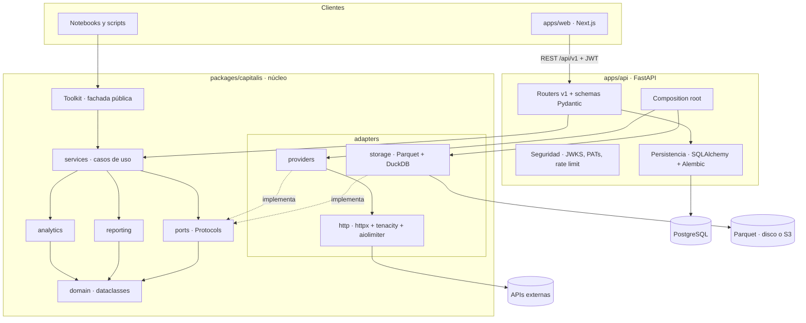
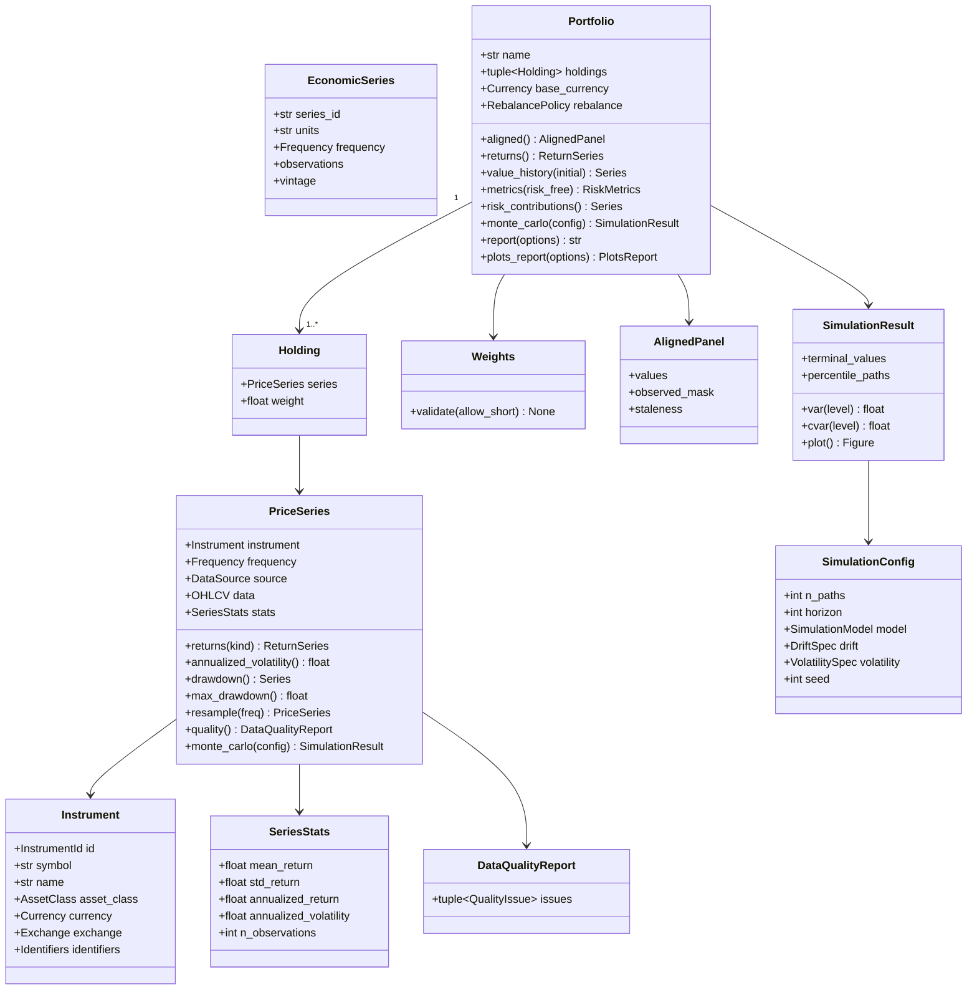

# Plan maestro — plataforma financiera personal

> Estado: **propuesta pendiente de aprobación**. Nombre provisional del producto: **Capitalis**
> (paquete `capitalis`). Si eliges otro nombre, se sustituye en todo el documento.

---

## 0. Decisiones tomadas a partir de tus respuestas

| # | Tema | Decisión |
|---|------|----------|
| 1–4 | Contexto | Repo personal, sin plazo. Objetivo: calidad de producto, no de práctica. B1-T1 se cumple al 100 % como primer módulo. |
| 3 | Estructura | Monorepo políglota con workspace `uv` (Python) y app Next.js. El núcleo es un paquete independiente que **no depende** de FastAPI ni de SQLAlchemy (lo garantiza el empaquetado, no solo la disciplina). |
| 5 | Git | Una rama `feat/*` por fase → PR a `development` con CI en verde. `main` se crea para releases (`v0.1.0` = B1-T1 completo). |
| 6 | Nombre | Sin "MIAX". Propuestas libres en PyPI y npm: **Capitalis** (recomendado), AlphaLedger, Capitalab. |
| 7 | Idioma | Código, docstrings, commits y API en inglés. README, docs y ADRs en español. UI y `report()` bilingües (`es` por defecto, `en` disponible). |
| 13 | Frecuencias | Desde 1 minuto hasta mensual (`1m, 5m, 15m, 30m, 1h, 4h, 1d, 1w, 1mo`). Cada proveedor declara qué frecuencias e histórico máximo sirve, y el router elige el que puede atender la petición. |
| 15 | Cripto | Clase de activo de primer nivel. Integración de CryptoWorld en la sección 9. |
| 16 | Rebalanceo | Política explícita: `BuyAndHold`, `Periodic(freq)` o `Threshold(band)`. Por defecto `Periodic(monthly)`, la misma en el histórico y en Monte Carlo. |
| 17 | Alineación | Nunca se inventan datos. Detalle en la sección 6. |
| 18 | Outliers | Se detectan y se reportan; nunca se borran. |
| 20 | Auth | Robusta y apta para despliegue público. Detalle en la sección 8. |
| 21 | Despliegue | Local con Docker Compose, diseñado *cloud-ready* (12-factor, almacenamiento de objetos para Parquet, secretos por entorno). |
| 22 | Gráficos | La API devuelve **datos tipados**, nunca especificaciones de gráficos. El frontend pinta con ECharts y Lightweight Charts. Matplotlib/seaborn solo en el núcleo (`plots_report()` y exportación de informes). Plotly queda fuera. |
| 23 | Docs | Zensical + mkdocstrings-python. |
| 26 | Enunciados | No se sube material de clase. `docs/enunciados/` se ignora en git; en el repo solo queda una matriz de trazabilidad con los requisitos redactada por nosotros. |

---

## 1. Árbol de carpetas

```
capitalis/
├── apps/
│   ├── api/                              # FastAPI (miembro del workspace uv) → paquete capitalis_api
│   │   ├── pyproject.toml
│   │   ├── src/capitalis_api/
│   │   │   ├── main.py                   # app factory
│   │   │   ├── bootstrap.py              # composition root: puertos → adaptadores
│   │   │   ├── settings.py               # pydantic-settings (prefijo CAPITALIS_API_)
│   │   │   ├── http/                     # errores RFC 9457, middlewares, request-id, CORS, cabeceras de seguridad
│   │   │   ├── security/                 # verificación JWT (JWKS), PATs, scopes, rate limiting
│   │   │   ├── persistence/              # modelos SQLAlchemy 2.0 async, repositorios, unit of work
│   │   │   ├── v1/                       # un router + schemas por feature
│   │   │   │   ├── market/  macro/  fx/  instruments/  fundamentals/
│   │   │   │   ├── portfolios/  analytics/  simulations/  reports/
│   │   │   │   └── providers/  modules/  me/  tokens/
│   │   │   └── modules/                  # routers aportados por cada bloque del máster
│   │   ├── migrations/                   # Alembic
│   │   └── tests/                        # unit/, integration/ (Postgres real en CI)
│   └── web/                              # Next.js (App Router) + TypeScript estricto
│       ├── src/app/
│       │   ├── (auth)/                   # login, 2FA, passkeys
│       │   └── (platform)/               # dashboard, markets, portfolios, simulations, modules/[slug], settings
│       ├── src/features/                 # lógica de UI por feature (market, portfolio, analysis, simulation…)
│       ├── src/components/ui/            # shadcn/ui
│       ├── src/components/charts/        # wrappers de Lightweight Charts y ECharts
│       ├── src/lib/api/                  # cliente GENERADO con orval (no se edita a mano)
│       ├── src/lib/auth/                 # Better Auth (servidor + cliente)
│       ├── src/modules/                  # una sección por bloque del máster + registry.ts
│       ├── messages/{es,en}.json         # i18n (next-intl)
│       └── e2e/                          # Playwright
├── packages/
│   └── capitalis/                        # NÚCLEO: librería pura, usable desde un notebook
│       ├── pyproject.toml                # extras: [yahoo] [crypto] [plots] [all]
│       ├── src/capitalis/
│       │   ├── domain/                   # dataclasses frozen + slots, sin I/O
│       │   │   ├── instruments.py        # Instrument, InstrumentId, Identifiers, AssetClass, Exchange
│       │   │   ├── money.py              # Currency (ISO 4217, unidades menores GBp→GBP), CurrencyPair
│       │   │   ├── time.py               # Frequency, TradingCalendar, AnnualizationBasis
│       │   │   ├── series.py             # PriceSeries, ReturnSeries, EconomicSeries, SeriesStats
│       │   │   ├── panel.py              # AlignedPanel (valores + máscara de observado + antigüedad)
│       │   │   ├── portfolio.py          # Portfolio, Holding, Weights, RebalancePolicy
│       │   │   ├── quality.py            # DataQualityReport, QualityIssue
│       │   │   ├── simulation.py         # SimulationConfig, SimulationResult
│       │   │   └── errors.py             # jerarquía de errores de dominio
│       │   ├── ports/                    # Protocols: proveedores, almacenamiento, reloj
│       │   ├── services/                 # casos de uso: ingesta, routing, alineación, FX, carteras, calidad
│       │   ├── analytics/                # returns, performance, risk, correlation, attribution, montecarlo/
│       │   ├── reporting/                # markdown (Jinja2), plots (matplotlib/seaborn), i18n
│       │   ├── adapters/
│       │   │   ├── http/                 # cliente httpx común: reintentos, rate limit, logging, User-Agent
│       │   │   ├── providers/            # yahoo/, alphavantage/, fred/, ecb/, … (uno por carpeta)
│       │   │   └── storage/              # Parquet + DuckDB sobre fsspec (disco local o S3/R2)
│       │   ├── modules/                  # registry.py + b1_toolkit/
│       │   ├── config/                   # Settings, logging (structlog)
│       │   └── toolkit.py                # fachada pública async + sync para notebooks
│       └── tests/
│           ├── unit/  property/  contract/  integration/
│           └── fixtures/                 # respuestas reales grabadas + datos sintéticos etiquetados
├── notebooks/                            # demos reproducibles (modo offline con fixtures)
├── docs/                                 # Zensical
│   ├── adr/                              # MADR: 0001-record-architecture-decisions.md, …
│   ├── architecture/                     # Mermaid: capas, clases, secuencias, C4
│   ├── data-sources/                     # ficha por proveedor: límites, licencia, sesgos
│   ├── modules/b1-t1/                    # trazabilidad requisito → código → test
│   └── reference/                        # API reference generada con mkdocstrings
├── infra/
│   ├── docker/                           # Dockerfiles multi-stage (api, web), usuario no-root
│   └── compose/                          # overrides (dev, observabilidad)
├── docker-compose.yml                    # api, web, postgres
├── justfile                              # setup, dev, test, lint, typecheck, gen-client, migrate, record-fixtures, docs
├── pyproject.toml                        # raíz del workspace uv + ruff, mypy, pytest, import-linter
├── uv.lock
├── zensical.yml / mkdocs.yml
├── CLAUDE.md · README.md · .env.example · .pre-commit-config.yaml · .editorconfig
└── .github/
    ├── workflows/                        # python.yml, web.yml, contract.yml (OpenAPI ↔ cliente), docker.yml
    └── dependabot.yml
```

**Por qué esta estructura y no `backend/` + `frontend/`:**

- `packages/capitalis` es la librería del enunciado: se importa en un notebook sin API ni base de datos.
- Como no declara FastAPI ni SQLAlchemy como dependencias, es imposible que el dominio las importe.
- Dentro del núcleo, `import-linter` verifica en CI las reglas de capas:
  - `domain` no importa nada del proyecto;
  - `services` solo depende de `ports`;
  - nadie salvo la fachada y el composition root importa `adapters`.
- `apps/` contiene los entregables desplegables. Mañana puede añadirse `apps/worker` o `apps/cli` sin tocar el núcleo.

---

## 2. Diagrama de capas



Las dependencias siempre apuntan hacia `domain`. Los adaptadores implementan los puertos y solo se instancian en dos composition roots: `Toolkit.from_settings()` para los notebooks y `bootstrap.py` para la API.

---

## 3. Modelo de dominio y puertos

### 3.1 Diagrama de clases (dominio)



**Detalles de diseño relevantes:**

- **`PriceSeries`** es `@dataclass(frozen=True, slots=True)`.
  - En `__post_init__` valida los datos y calcula `SeriesStats` (media y desviación típica de los retornos, como exige el enunciado) a través de un campo `init=False`.
  - Los arrays se copian y se marcan como solo lectura (`writeable=False`) para que la inmutabilidad sea real y no solo superficial.
- **Anualización.** Depende del calendario del activo y de la frecuencia:
  - 252 sesiones al año en equities, 365 días en cripto;
  - en intradía, número de barras por sesión × sesiones al año.

  No hay un 252 cableado en el código.
- **Representación temporal.** Las barras intradía usan timestamps UTC tz-aware. Las diarias o superiores usan etiquetas de sesión con la zona horaria del mercado como metadato. Irá en un ADR propio.
- **`EconomicSeries` es bitemporal.** Distingue fecha de observación, fecha de publicación y vintage (ALFRED). Es un tipo distinto de `PriceSeries`: un tipo de interés no tiene "retornos".
- **FX y futuros** son `PriceSeries` con `AssetClass.FX` o `AssetClass.FUTURE`. Una `CurrencyPair` es un instrumento más.

### 3.2 Puertos (`ports/`)

| Puerto | Responsabilidad |
|--------|-----------------|
| `MarketDataProvider` | `fetch_bars(BarsRequest) -> PriceSeries`, `search(query) -> list[Instrument]`. Declara `ProviderCapabilities`: clases de activo, frecuencias, histórico máximo por frecuencia, autenticación, rate limit y licencia. |
| `MacroDataProvider` | `fetch_series(id, vintage=None) -> EconomicSeries` |
| `FundamentalsProvider` | snapshot, estados financieros point-in-time, acciones corporativas |
| `FxRateProvider` | tipos de cambio oficiales (`CurrencyPair`, intervalo) |
| `InstrumentResolver` | ticker ↔ FIGI / ISIN / CIK y símbolo propio de cada proveedor |
| `SeriesStore` | caché de series: lectura y escritura con metadatos de cobertura, TTL y `retrieved_at` |
| `PortfolioRepository` | persistencia de carteras guardadas (implementado en `apps/api`) |
| `Clock` | tiempo inyectable para tests de TTL y reproducibilidad |

### 3.3 Servicios (casos de uso)

| Servicio | Responsabilidad |
|----------|-----------------|
| `MarketDataService` | Cache-aside, routing por capacidades con fallback ordenado por política, y descarga concurrente de N series. Devuelve `BatchResult` (éxitos y fallos con su causa) sin abortar el lote. Si el proveedor revisa el histórico (por ejemplo, un nuevo ajuste por dividendos), lo detecta y reingesta la serie. |
| `AlignmentService` | Une calendarios distintos sin inventar datos (sección 6). |
| `CurrencyService` | Conversión as-of a la divisa base y descomposición del retorno en activo + divisa (sección 7). |
| `RiskFreeRateService` | Tipo libre de riesgo según la divisa base. |
| `PortfolioService` | Construye la cartera: valida pesos, descarga, alinea y convierte. |
| `DataQualityService` | Huecos frente al calendario oficial, outliers (z-score robusto con MAD), precios congelados, splits sospechosos, volumen cero. |
| `SimulationService` y `ReportService` | Orquestan analytics y reporting. |

### 3.4 Política de validación estricta (requisito 4.5, irá en un ADR)

**No se acepta cualquier cosa que "parezca" una serie de precios.** Un `PriceSeries` exige:

- índice temporal tipado, monótono y sin duplicados;
- precios finitos y estrictamente positivos;
- divisa ISO conocida;
- frecuencia declarada y coherente con el índice;
- procedencia (`DataSource`);
- longitud mínima para sus estadísticos.

Las entradas externas (CSV, DataFrames de usuario) pasan antes por un `SeriesImporter` con Pydantic. Si algo falla, el error es tipado y explica qué falló y dónde.

**Por qué:** un error silencioso en la entrada (precio en peniques frente a libras, split sin ajustar, zona horaria mal puesta, frecuencia mezclada) contamina todas las métricas aguas abajo sin que nadie lo note. Fallar pronto y con claridad es más barato que depurar un Sharpe falso.

---

## 4. Fuentes de datos

Investigué el estado actual de cada proveedor. Los límites de los planes gratuitos cambian a menudo, así que cada adaptador declara sus límites como configuración y `docs/data-sources/` tendrá una ficha por fuente.

| Fuente | Qué aporta | Frecuencias | Acceso | Notas | Fase |
|--------|-----------|-------------|--------|-------|------|
| **Yahoo Finance** (`yfinance`) | Acciones, índices, ETFs, FX, futuros y cripto; fundamentales, dividendos/splits, opciones | 1m…1mo (1m ≈ 30 días; ≤30m ≈ 60 días; 1h ≈ 2 años) | Sin clave | Sin SLA y con throttling (429) frecuente → caché, rate limit y fallback | F2 |
| **Alpha Vantage** | Acciones/ETF, FX, cripto, intradía, fundamentales, noticias con sentimiento | 1m…1mo | Clave gratuita | 25 peticiones/día; el ajustado es premium; sin índices. Fallback de equities y validación cruzada | F2 |
| **FRED + ALFRED** | Macro, tipos, FX (`DEX*`), vintages point-in-time | D…A | Clave gratuita | ALFRED evita el *look-ahead bias* de las revisiones | F2 |
| **BCE Data Portal** (SDMX) | €STR, tipos de cambio de referencia, curvas cupón cero, HICP | D, M | Sin clave | Fuente oficial para EUR | F2 |
| **Tiingo** | EOD EE. UU. ajustado (30+ años), intradía IEX, cripto | 1m…1d | Clave gratuita | Licencia de uso personal | F11 |
| **Alpaca Market Data** | Barras de EE. UU. por minuto desde 2016; cripto | 1m…1d | Cuenta gratuita | En el plan free se bloquean los últimos 15 minutos; la mejor fuente gratuita de intradía de EE. UU. | F11 |
| **SEC EDGAR** | Fundamentales XBRL con fecha de presentación (point-in-time), 10-K/10-Q/8-K para NLP | Q, A, eventos | User-Agent con email | 10 peticiones/s | F11 |
| **OpenFIGI + SEC tickers + GLEIF** | Maestro de instrumentos (FIGI, CIK, LEI) | — | Clave opcional | El ticker deja de ser la clave primaria | F11 |
| **DBnomics** | Agregador: FMI, OCDE, BIS, Banco Mundial, Eurostat… | Varias | Sin clave | Un adaptador da acceso a más de 90 organismos | F11 |
| **Eurostat, Banco de España, INE** | Macro europea y española | M, Q, A | Sin clave | APIs oficiales | F11 |
| **US Treasury** (FiscalData, par yield curve) | Curva oficial de EE. UU. | D | Sin clave | | F11 |
| **Kenneth French Data Library** | Factores Fama-French, momentum, carteras | D, W, M | Sin clave | Base de los modelos factoriales de bloques futuros | F11 |
| **Cboe** | Histórico del VIX y otros índices de volatilidad | D | Sin clave | | F11 |
| **ccxt** (Binance, Kraken, Coinbase, KuCoin…) | OHLCV cripto con histórico completo, order books, funding | 1m… | Endpoints públicos | Sustituye a los clientes propios de CryptoWorld | F12 |
| **CoinGecko** | Capitalización, dominancia, metadatos | D | Clave demo gratuita | | F12 |
| **Blockchain.com, Blockchair, DefiLlama** | Métricas on-chain, multichain, TVL | D | Sin clave | Portadas de CryptoWorld, más DefiLlama | F12 |
| **alternative.me, CryptoCompare** | Fear & Greed cripto, noticias | D | Sin clave / clave | Portadas de CryptoWorld | F12 |
| **Massive** (antes Polygon) | Agregados de EE. UU. | 1m…1d | Clave gratuita | 5 peticiones/min, 2 años de histórico | Backlog |
| **CFTC COT** | Posicionamiento en futuros | W | Sin clave | | Backlog |
| **GDELT, Finnhub (noticias)** | Noticias y tono | Eventos | Varía | Futuro módulo de sentimiento | Backlog |
| **CNMV** | Posiciones cortas y hechos relevantes (España) | Eventos | Scraping ético | Frágil: sin API | Backlog |

**Descartadas, por ahora:**

| Fuente | Motivo |
|--------|--------|
| Stooq | Desde marzo de 2026 exige una clave obtenida resolviendo un captcha: no es automatizable. |
| Velas de Finnhub | Pasaron a planes de pago hacia 2025. |
| Nasdaq Data Link | Casi todo es premium; lo útil gratuito ya está en FRED o DBnomics. |
| IEX Cloud | Cerró en 2024. |
| Twelve Data | Redundante; su licencia gratuita es solo para uso personal. |

**Política de routing por defecto** (configurable en `settings`):

| Dato | Orden de proveedores |
|------|----------------------|
| Equities e índices, diario | Yahoo → Tiingo → Alpha Vantage |
| Equities EE. UU., intradía | Alpaca → Yahoo → Alpha Vantage |
| FX | BCE → FRED → Yahoo |
| Cripto | ccxt (Binance) → ccxt (Kraken) → CoinGecko |
| Macro | FRED/ALFRED → BCE → DBnomics |

**Almacenamiento:**

- Parquet particionado por `dataset/provider/frequency/symbol/year`, consultado con DuckDB.
- TTL por tipo de dato y descarga incremental (solo el tramo que falta).
- `retrieved_at` en cada escritura, como base de la quality gate que detecta revisiones del histórico.

---

## 5. Monte Carlo (requisito 4.4, con mejoras propuestas)

**Modelos:**
- `GBM` multivariante con Cholesky (por defecto). Si la matriz no es definida positiva, se repara a la matriz PSD más cercana.
- `StudentT` multivariante para colas gruesas.
- `StationaryBootstrap` (Politis-Romano), que conserva la autocorrelación y las correlaciones cruzadas.
- Después: *Filtered Historical Simulation* con GARCH.

**Estimación de parámetros:**
- Covarianza con shrinkage Ledoit-Wolf, más estable que la muestral.
- Drift: `Historical`, `Assumed(μ)`, `Zero` o `RiskFreePlusPremium`. La media histórica es muy ruidosa, y el informe lo advertirá.

**Rendimiento:**
- Totalmente vectorizado con NumPy (sin bucles por simulación).
- Se procesa por lotes con memoria acotada: 10 000 trayectorias × 252 pasos × 20 activos en float64 ocuparían unos 400 MB de una vez.
- Variables antitéticas para reducir varianza.

**Salida:**
- Percentiles de trayectorias (abanico) y distribución del valor final.
- VaR y CVaR al 95 % y al 99 %, con **error estándar Monte Carlo e intervalo de confianza**.

**Consistencia y reproducibilidad:**
- El rebalanceo de la cartera se aplica igual dentro de la simulación que en el histórico.
- Semilla con `numpy.random.Generator(PCG64)`. El resultado guarda la configuración completa para reproducirlo.

---

## 6. Alineación de calendarios sin inventar datos (respuesta a tu punto 17)

Separo tres usos distintos, porque cada uno necesita un tratamiento diferente:

1. **Estadísticos por activo.** Cada serie se analiza sobre su propio calendario, sin relleno. Los huecos se contrastan con el calendario oficial del mercado (`exchange_calendars`) para distinguir un festivo de un dato que falta.

2. **Estadísticos entre activos** (covarianza, correlación, Monte Carlo):
   - Los retornos se calculan en el calendario de cada activo y luego se unen por fecha (*outer join*).
   - Un día de festivo en Madrid queda como **NaN**, no como 0 %. El retorno acumulado del puente se asigna a la siguiente sesión real, así que no aparecen ceros ficticios que bajen la volatilidad y la correlación.
   - La covarianza usa observaciones *pairwise-complete* con reparación PSD.
   - Para carteras que mezclan Europa y EE. UU., el informe avisa del sesgo por **trading no sincrónico** (cierres con 6 horas de diferencia) y ofrece la correlación semanal como alternativa robusta.

3. **Valoración de la cartera** (evolución del valor):
   - Se usa el último precio de cierre **observado**, que es el mark-to-market correcto: es el criterio con el que se calcula el NAV de un fondo.
   - Cada punto lleva su **antigüedad** (sesiones desde la última observación real) y el informe la muestra.
   - Nunca se presenta como una observación nueva.

**Reglas fijas:**
- Prohibidos el `bfill` y la interpolación.
- La macro mensual o trimestral se une *as-of* por fecha de publicación (vía ALFRED), nunca por fecha de observación.

---

## 7. Divisas y tipo libre de riesgo (respuesta a tu punto 11)

**Divisas:**
- Cada serie conserva su divisa nativa.
- Las unidades menores se normalizan: Yahoo da las acciones de Londres en peniques (GBp → GBP / 100), un error clásico.
- La cartera tiene una **divisa base configurable** (EUR por defecto).
- La conversión es *as-of*: el precio en *t* usa el último fixing conocido en *t*. El fixing del BCE (~16:00 CET) es anterior a los cierres de Madrid y de Nueva York, así que no hay *look-ahead*.

**Tipos de cambio:**
- Orden de fuentes: BCE (oficial) → FRED `DEX*` → Yahoo (intradía y pares exóticos).
- Los cruces que falten se triangulan vía EUR o USD.

**Atribución del retorno:**
- El informe separa **retorno del activo en moneda local** y **contribución de la divisa**. Para un inversor en euros, el riesgo divisa es riesgo real.
- La cobertura de divisa queda para más adelante.

**Tipo libre de riesgo según la divisa base:**

| Divisa | Fuente |
|--------|--------|
| EUR | €STR del BCE; antes de octubre de 2019, tipo de depósito del BCE |
| USD | SOFR o T-Bill a 3 meses (FRED) |
| GBP | SONIA (más adelante) |

La conversión a tipo por periodo usa la convención del mercado monetario (ACT/360). El Sharpe y el Sortino usan siempre el tipo de la divisa base.

---

## 8. Autenticación (respuesta a tu punto 20)

**Recomendación: Better Auth en Next.js con patrón BFF, y la API como *resource server* OIDC estándar.**

**En la web, con Better Auth:**
- Contraseña con hash fuerte.
- **Passkeys (WebAuthn)**.
- **2FA TOTP obligatorio** con códigos de recuperación.
- Sesiones en Postgres (esquema `auth` separado), en cookies `HttpOnly`, `Secure` y `SameSite=Lax`, con protección CSRF.
- Rate limiting en login.
- **Registro público deshabilitado**: el primer usuario se crea por CLI. La app es personal, pero ya queda preparada para multiusuario.

**En la API:**
- Recibe JWT de corta duración, firmados con EdDSA.
- Los verifica contra el **JWKS** publicado por la web con PyJWT. No contiene lógica de login.
- Si mañana se migra a Keycloak, Zitadel o Auth0, solo cambian el *issuer* y la URL del JWKS: la verificación está detrás del puerto `TokenVerifier`.

**Para notebooks y scripts:**
- **Personal Access Tokens** emitidos por la API: con scopes y caducidad, revocables, almacenados como hash y mostrados una sola vez.

**Seguridad transversal:**
- Rate limiting por usuario y por IP.
- CORS estricto.
- Cabeceras de seguridad (CSP, HSTS).
- Auditoría de eventos de seguridad.
- `gitleaks` en pre-commit.

**Alternativas descartadas:**

| Alternativa | Motivo |
|-------------|--------|
| Auth propia en FastAPI | Más código crítico que mantener y auditar. |
| Keycloak autoalojado | Excesivo para un único desarrollador. |
| Clerk / Auth0 | Dependencia de un proveedor y datos de usuario fuera de casa. |

---

## 9. Integración con CryptoWorld (respuesta a tu punto 15)

**Qué hay en CryptoWorld:**
- Django 5 + DRF + Celery/Redis, y un frontend React/Vite. Unas 25k líneas.
- Clientes para Binance, KuCoin y CoinGecko con cadena de fallback.
- Un motor de análisis técnico de unas 900 líneas: RSI, MACD, Bollinger, medias, SAR, *signals dashboard*, patrones de velas, predicción con Random Forest y backtesting.
- Métricas on-chain (Blockchain.com, Blockchair), noticias (CryptoCompare), Fear & Greed, alertas, cartera con largos y cortos, y 2FA.

**Propuesta: migración progresiva (*strangler*) hacia esta plataforma**, sin integrarse por HTTP con CryptoWorld ni crear una librería compartida.

| Pieza de CryptoWorld | Destino en la nueva plataforma |
|----------------------|--------------------------------|
| Clientes de Binance y KuCoin | **ccxt**: un solo adaptador para más de 100 exchanges con la misma interfaz. |
| Cliente de CoinGecko, on-chain, noticias, Fear & Greed | Adaptadores que implementan los puertos del núcleo, devolviendo objetos de dominio. |
| Motor de análisis técnico | `capitalis.analytics.technical`, **generalizado a cualquier `PriceSeries`** (también acciones e índices), tipado y con tests de propiedades. La librería `ta` está sin mantenimiento: los indicadores básicos se implementan vectorizados con NumPy, o con TA-Lib (decisión en un ADR). |
| Predicción ML y backtesting | Se reescriben con un protocolo anti-*look-ahead* (walk-forward). Tienen más sentido en el bloque del máster dedicado a ML, como módulo propio. |
| Alertas y Celery | Worker de jobs de la plataforma (fase F13). |
| Pantallas (velas, Fear & Greed, multichain…) | Sección "Cripto" del frontend, reutilizando el diseño de los componentes. |

CryptoWorld sigue funcionando tal cual mientras dura la migración. Cuando la nueva plataforma cubra sus funcionalidades, podrás archivarlo o mantenerlo como proyecto académico del TFG.

---

## 10. API REST (`/api/v1`)

Los errores siguen **RFC 9457** (`application/problem+json`). La paginación es por cursor y las fechas van en ISO 8601. El OpenAPI se documenta con ejemplos.

| Método | Ruta | Descripción |
|--------|------|-------------|
| GET | `/health/live`, `/health/ready` | Liveness y readiness (BD, almacenamiento) |
| GET | `/api/v1/providers` | Proveedores: capacidades, estado, cuota consumida, último error |
| GET | `/api/v1/modules` | Módulos del máster registrados (alimenta la navegación) |
| GET | `/api/v1/instruments/search?q=` | Búsqueda de instrumentos multi-proveedor |
| GET | `/api/v1/instruments/{id}` | Detalle e identificadores (ISIN, FIGI, CIK) |
| GET | `/api/v1/market/bars` | Barras de un símbolo (`interval`, `start`, `end`, `adjusted`, `provider?`) |
| POST | `/api/v1/market/bars/batch` | N símbolos concurrentes → `{succeeded, failed}` |
| GET | `/api/v1/market/stats` | Estadísticos de una o varias series |
| POST | `/api/v1/market/compare` | Rendimiento normalizado, correlación y drawdown de varios activos |
| GET | `/api/v1/market/quality` | Informe de calidad (huecos, outliers, precios congelados) |
| GET | `/api/v1/fundamentals/{symbol}` | Snapshot y estados financieros (`period=annual\|quarterly`) |
| GET | `/api/v1/macro/series/{source}/{id}` | Serie macro (`vintage?` para point-in-time) |
| GET | `/api/v1/rates/risk-free?currency=` | Tipo libre de riesgo |
| GET | `/api/v1/fx/rates?base=&quote=` | Tipos de cambio |
| GET, POST | `/api/v1/portfolios` | Listar y crear carteras |
| GET, PUT, DELETE | `/api/v1/portfolios/{id}` | Detalle, edición y borrado (con versión optimista) |
| POST | `/api/v1/portfolios/validate` | Validación de pesos y activos sin guardar |
| GET | `/api/v1/portfolios/{id}/analytics` | Métricas, correlaciones, evolución, drawdown, contribución al riesgo y atribución de divisa |
| GET | `/api/v1/portfolios/{id}/report?format=md\|html\|pdf&lang=` | Informe descargable |
| POST | `/api/v1/simulations` | Lanza una simulación (activo o cartera). `200` si es pequeña; `202` + job si es grande |
| GET | `/api/v1/simulations/{id}` | Resultado: percentiles, histograma, VaR/CVaR con error estándar |
| GET | `/api/v1/me` | Usuario actual |
| GET, POST, DELETE | `/api/v1/tokens` | Personal Access Tokens |
| — | `/api/v1/modules/b1-toolkit/...` | Endpoints propios del bloque, si los necesita |

Los routers no contienen lógica de negocio: validan con Pydantic, llaman a un caso de uso y mapean el resultado a un schema.

---

## 11. Frontend

**Estética:** terminal financiero en tema oscuro, con densidad de información alta y bien jerarquizada:
- tipografía tabular para cifras;
- verde y rojo accesibles (con contraste comprobado y sin depender solo del color);
- atajos de teclado (`⌘K` para buscar un ticker).

| Pantalla | Contenido |
|----------|-----------|
| **Login / 2FA / Passkeys** | Flujo Better Auth |
| **Dashboard** | Carteras guardadas (valor, rentabilidad, drawdown actual, sparkline), estado de proveedores (salud y cuota), avisos de calidad de datos |
| **Explorador de mercado** | Búsqueda de tickers, velas con Lightweight Charts (y selector de frecuencia), estadísticos, comparación de varios activos (base 100, correlación, drawdown con ECharts), informe de calidad |
| **Constructor de carteras** | Selección de activos, pesos con sliders y entrada numérica (validación zod en vivo: suma 1, cortos solo si se permiten), divisa base, política de rebalanceo, guardar y cargar |
| **Análisis de cartera** | Tarjetas KPI, evolución con antigüedad de datos, drawdown, matriz de correlación, contribución al riesgo, atribución de divisa, informe Markdown renderizado y descargable (MD, HTML, PDF) |
| **Simulador Monte Carlo** | Parámetros editables (modelo, trayectorias, horizonte, drift, volatilidad, semilla), abanico de percentiles, histograma del valor final con VaR/CVaR marcados, tabla de riesgo con intervalos de confianza |
| **Módulos del máster** | Navegación generada desde `GET /modules` más `src/modules/registry.ts`. B1-T1 incluye la matriz requisito → código → test y la demo |
| **Ajustes** | Seguridad (passkeys, 2FA, sesiones activas, PATs), preferencias (idioma, divisa base) |
| *Más adelante* | Macro, fundamentales, cripto (portado de CryptoWorld), alertas |

**Calidad:**
- Estados de carga con *skeletons*, errores (Problem Details mapeados a mensajes útiles) y vacíos en cada pantalla.
- Diseño responsive y accesibilidad (roles ARIA, foco visible, navegación por teclado).
- Vitest + Testing Library para componentes y Playwright para los flujos principales.

---

## 12. Calidad, testing y CI

**Python:**
- `ruff` (lint y formato).
- `mypy --strict` con el plugin de Pydantic y `pandas-stubs`.
- `import-linter` (reglas de capas).
- `pytest` + `pytest-cov`, con umbral de cobertura del 90 % en el núcleo.

**Tipos de tests:**

| Tipo | Qué cubre |
|------|-----------|
| Unitarios | Dominio y analytics |
| Property-based (`hypothesis`) | Invariantes: escalar los precios no cambia los retornos; volatilidad cero da una trayectoria determinista; VaR monótono en el nivel de confianza; los pesos validados suman 1… |
| Contrato de proveedores | Todos los adaptadores pasan la misma batería contra respuestas reales grabadas, mockeadas con `respx`. Ninguna llamada real en CI. |
| Integración | API contra Postgres real (servicio de CI) |
| E2E | Playwright |

**Fixtures:**
- `just record-fixtures` graba respuestas reales de las APIs.
- Los datos sintéticos (GBM con semilla) viven en una carpeta aparte y se marcan como sintéticos.

**Contrato OpenAPI ↔ cliente:**
- La CI regenera el cliente con orval y falla si hay diferencias. Así no hay tipos duplicados que se desincronicen.

**Workflows de GitHub Actions:**
- Python y web en cada PR.
- Build de imágenes Docker y E2E en PR a `main` y en tags, para no gastar minutos de un repo privado.
- Dependabot para dependencias y acciones.

**Versiones:**
- Python 3.14 para desarrollo, con `requires-python >= 3.13` y CI en ambas.
- El resto de herramientas en su última estable, fijadas en los lockfiles.

---

## 13. Fases de implementación

Cada fase va en su rama `feat/*`, con commits Conventional pequeños, y se cierra con un PR a `development` con lint, typecheck y tests en verde, más un resumen de lo hecho, lo pendiente y la deuda técnica.

| Fase | Rama | Contenido | Hito |
|------|------|-----------|------|
| **F0** | `chore/bootstrap` | Workspace uv, paquetes vacíos, ruff/mypy/pytest/import-linter/pre-commit, justfile, `CLAUDE.md`, plantilla MADR + ADRs 0001–0004 (registro de decisiones, monorepo hexagonal, tooling, idioma), `.env.example`, `.gitignore`, esqueleto de docs con Zensical, CI de Python | Repo profesional vacío |
| **F1** | `feat/domain-model` | Instrument, Currency, Frequency/Calendar, PriceSeries con estadísticos automáticos, ReturnSeries, EconomicSeries, Weights, Portfolio (validación + alineación), DataQualityReport, errores; ADR de validación estricta; tests unitarios y de propiedades | Modelado 4.3 |
| **F2** | `feat/market-data` | Puertos, registro de proveedores, routing y fallback, infraestructura HTTP (httpx + tenacity + aiolimiter), adaptadores de Yahoo, Alpha Vantage, FRED/ALFRED y BCE; ingesta concurrente con `BatchResult`; almacén Parquet + DuckDB con TTL e incremental; tests de contrato; `record-fixtures` | Ingesta 4.2 |
| **F3** | `feat/analytics` | Retornos, rendimiento (CAGR, volatilidad, Sharpe, Sortino, Calmar), riesgo (max drawdown, VaR/CVaR histórico, paramétrico y Cornish-Fisher), correlaciones (pairwise y semanal), contribución al riesgo, motor de rebalanceo, servicio de divisas y tipo libre de riesgo, limpieza y calidad | Limpieza 4.5 (parte) |
| **F4** | `feat/monte-carlo` | Motor GBM / Student-t / bootstrap, lotes, antitéticas, Ledoit-Wolf, `PriceSeries.monte_carlo()` y `Portfolio.monte_carlo()`, visualización (abanico + histograma con VaR/CVaR) | Monte Carlo 4.4 |
| **F5** | `feat/reporting` | `report()` Markdown parametrizable (es/en) con diagnósticos y advertencias, `plots_report()` (rendimiento comparado, correlación, evolución, drawdown, contribución al riesgo), fachada `Toolkit`, módulo `b1_toolkit` + registro, notebook de demo, README completo, diagramas Mermaid (clases, capas, secuencia ingesta → cartera → simulación → reporte) | **B1-T1 completo como librería → `v0.1.0`** |
| **F6** | `feat/api` | FastAPI: app factory, composition root, settings, RFC 9457, structlog, health, OpenAPI, Postgres + SQLAlchemy async + Alembic, carteras persistidas, endpoints de mercado, analytics, simulaciones e informes; `docker-compose` con Postgres | API funcional (local) |
| **F7** | `feat/auth` | Better Auth (passkeys, TOTP, sesiones), verificación JWKS en la API, PATs, rate limiting, cabeceras de seguridad, auditoría | Lista para exponerse |
| **F8** | `feat/web-foundation` | Next.js, Tailwind, shadcn, tema oscuro, layout y navegación con registro de módulos, orval + TanStack Query, i18n, pantallas de auth | Shell del frontend |
| **F9** | `feat/web-core-screens` | Dashboard, Explorador, Constructor, Análisis, Simulador; Vitest + Playwright | **Plataforma completa → `v0.2.0`** |
| **F10** | `chore/containers` | Dockerfiles multi-stage sin root, compose completo (api, web, postgres), CI de imágenes, `just dev` levanta todo | Un comando |
| **F11** | `feat/data-expansion` | Tiingo, Alpaca (intradía), SEC EDGAR (fundamentales point-in-time y filings), OpenFIGI (maestro de instrumentos), DBnomics, Eurostat, Banco de España, INE, US Treasury, Kenneth French, Cboe | Catálogo de datos |
| **F12** | `feat/crypto` | ccxt, CoinGecko, on-chain, Fear & Greed, noticias; análisis técnico generalizado (portado de CryptoWorld); sección Cripto | Integración CryptoWorld |
| **F13** | `feat/jobs` | Worker (refrescos programados, alertas, simulaciones largas) — ADR: Procrastinate (cola sobre Postgres, sin Redis) frente a Taskiq + Redis; notificaciones en tiempo real por SSE | Plataforma "viva" |
| **F14** | `chore/cloud` | Parquet en almacenamiento de objetos, secretos, observabilidad (OpenTelemetry + Sentry), backups, despliegue (ADR: Railway, Fly.io o VPS + Caddy) | Producción |

Fases F0–F5: cumplen el taller al 100 %. Fases F6–F10: la plataforma. Fases F11 en adelante: crecimiento.

---

## 14. ADRs previstos (MADR)

1. Registrar decisiones de arquitectura con MADR
2. Monorepo con núcleo hexagonal como paquete independiente
3. Tooling: uv, ruff, mypy strict, import-linter, just
4. Política de idioma (código en inglés, documentación en español, UI bilingüe)
5. Validación estricta de entradas (requisito 4.5)
6. Representación temporal (UTC intradía, etiquetas de sesión en diario)
7. Alineación sin relleno artificial y valoración as-of
8. `yfinance` en hilo dedicado frente a cliente propio; httpx para APIs oficiales
9. Caché Parquet + DuckDB con TTL, sobre fsspec
10. pandas en la interfaz pública; sin polars (volúmenes pequeños)
11. Divisa base, conversión as-of y tipo libre de riesgo por divisa
12. Modelos de Monte Carlo y estimación de covarianza
13. Autenticación: Better Auth (BFF) + verificación JWKS en la API
14. La API sirve datos, no gráficos (fuera Plotly)
15. Zensical + mkdocstrings para la documentación
16. Cliente del frontend generado con orval
17. Estrategia de migración desde CryptoWorld

---

## 15. Pendiente de tu confirmación

1. **Nombre:** Capitalis (recomendado), AlphaLedger o Capitalab. Comprobé que están libres en PyPI y npm; no he verificado marcas registradas.
2. **Autenticación:** Better Auth + JWKS en la API, con passkeys y TOTP obligatorio.
3. **Merges:** ¿hago yo el merge (squash) de los PR `feat/*` → `development` cuando la CI esté en verde, o prefieres hacerlo tú?
4. **Red del entorno:** no puedo cambiar la configuración del entorno de cloud. Tienes que añadir los dominios de la sección 16.
5. **Claves de API:** FRED y Alpha Vantage para F2. Tiingo, Alpaca y CoinGecko (demo) para F11 y F12. La SEC solo exige un email en el User-Agent.
6. **CryptoWorld:** estrategia de migración progresiva (sección 9).

## 16. Dominios a permitir en el entorno de cloud

- **F2:** `query1.finance.yahoo.com`, `query2.finance.yahoo.com`, `fc.yahoo.com`, `finance.yahoo.com`, `guce.yahoo.com`, `www.alphavantage.co`, `api.stlouisfed.org`, `data-api.ecb.europa.eu`
- **F11:** `api.tiingo.com`, `data.alpaca.markets`, `www.sec.gov`, `data.sec.gov`, `api.openfigi.com`, `api.db.nomics.world`, `ec.europa.eu`, `www.bde.es`, `servicios.ine.es`, `api.fiscaldata.treasury.gov`, `home.treasury.gov`, `mba.tuck.dartmouth.edu`, `cdn.cboe.com`
- **F12:** `api.binance.com`, `api.kraken.com`, `api.exchange.coinbase.com`, `api.kucoin.com`, `api.coingecko.com`, `api.blockchain.info`, `api.blockchair.com`, `api.llama.fi`, `api.alternative.me`, `min-api.cryptocompare.com`
